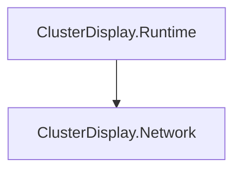

# Migration Progress – Unity Cluster Display

## Ausgangslage
- Unity alt → Ziel: … → …
- Compile-Baseline (Datum): Fehler …, Obsolete …, Warnungen gesamt …
- Render Pipelines: …
- Netzwerk-Stack (Ist): …

## Assembly-Abhängigkeiten

## Entscheidungen
| Datum | Entscheidung | Begründung | Offen? |
|---|---|---|---|
| | Transport: … | … | |

## Backlog
Status: `[ ]` offen · `[~]` in Arbeit · `[x]` erledigt · `[-]` aufgeteilt · `[manuell]` Hardware-Prüfung durch Nutzer

| ID | Status | Modul | Aufgabe | Abhängig von | Skill | Abnahme |
|---|---|---|---|---|---|---|
| M-01 | [ ] | Build | Compile-Blocker durch entfernte APIs isolieren | – | unity-api-migration | 0 Fehler |
| M-02 | [ ] | Core | PlayerLoop-API auf UnityEngine.LowLevel | M-01 | unity-api-migration | 0 Fehler, Obsolete sinkt |

## Log
| Datum | ID | Ergebnis (Fehler / Obsolete / Tests) | Commit | Notizen |
|---|---|---|---|---|
