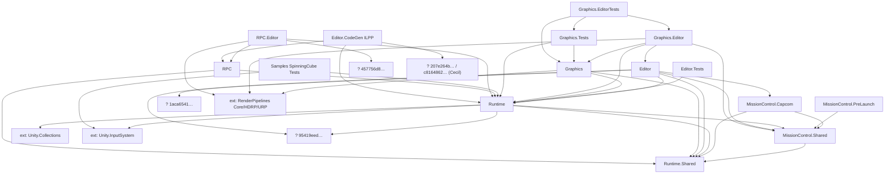

# Migration Progress – Unity Cluster Display

Stand der Erstanalyse: 2026-10-08 (Branch `dotnet-update`). Gemeinsames Gedächtnis zwischen Sessions – nach jedem Task Status, Messwerte und Commit eintragen.

## Ausgangslage
- Unity: alt 2023.1 (Package-Minimum) / Testprojekte 2020.1 … 6000.2.8f1 → Ziel **6000.3.26f1 LTS** → danach Folgemeilenstein **6.7 LTS** (derzeit nicht installiert). 6.0 LTS endet 2026-10-16.
- Compile-Baseline (2026-10-08, Editor **6000.3.13f1**, voller Compile): `pfcClusterBasicTestURP` (URP) **0 Fehler / 9 Obsolete / 10 Warnungen**; `GraphicsDemoProject` (HDRP) **0 Fehler / 15 Obsolete / 15 Warnungen** (davon 6 in Package-Tests, 1 im Demo-Projekt). Ziel-Patchlevel 6000.3.26f1 nicht installiert.
  - Aus den vorhandenen Bee-Logs von `TestProjects/pfcClusterBasicTestURP` (6000.2.8f1, URP 17.2): 0 Fehler; Warnungen u. a. CS0618 `ClusterSerialization` (`ClusterSync.cs`, `EmitterStateWriter.cs`, `RepeaterStateReader.cs`), `ScriptableRenderPass.Execute` (`InjectionPointRenderFeature.cs`), `cameraColorTargetHandle` (`UrpPresenter.cs`), `FindObjectsOfType` (3 Stellen), `renderPipelineAsset` (`UrpUtility.cs`).
- Render Pipelines: URP (`pfcClusterBasicTestURP`, `GraphicsTestsURP`) und HDRP (`GraphicsDemoProject`, `GraphicsTestsHDRP`); `pfcClusterBasicTestURP` läuft mit `m_EnableRenderCompatibilityMode: 1`.
- Netzwerk-Stack (Ist): **eigenes UDP** (`System.Net.Sockets`), kein UNet/Unity Transport: `Runtime/Networking/UDPAgent.cs` (+ `FrameDataAssembler`, `FrameDataSplitter`), `Runtime/Node/{Emitter,Repeater}Node.cs`, `Runtime/Scripting/EditorLink.cs`; MissionControl/Capsule/Capcom nutzen ebenfalls Sockets (außerhalb Frame-Sync-Pfad).
- Scripting-Backend: Mono, Windows x64, D3D11/D3D12.
- Packages: `com.unity.cluster-display`, `.graphics`, `.rpc` (alle `0.1.0-preview`, `unity: 2023.1`); `GfxPluginQuadroSync` (C++/NvAPI, Binary eingecheckt); `MissionControlSystem` (.NET 8, Blazor); 15 `.asmdef` in `source/`.
- Grep-Inventar `source/*.cs` (Dateien / Treffer): `FindObjectsOfType|FindObjectOfType` 8/10 · `GraphicsSettings.renderPipelineAsset` 1/1 · `ClusterSerialization` 3/5 · `AppDomain.CurrentDomain.GetAssemblies` 6/7 · `Shader.Find` 3/3 · `RenderPipelineManager` 1/3 · `UnityEngine.Input`/`Input.Get*`, `OnRenderImage`, `onPreRender`, `Experimental.LowLevel`: **0** (Standardfälle der Skills treffen kaum zu).
- Testprojekte (`ProjectVersion.txt`): 6000.2.8f1 `GraphicsDemoProject`, `pfcClusterBasicTestURP`; 2022.3.62f2 `ClusterRenderTest`, `ClusterSyncTests`, `GraphicsTestsURP`, `RPCTests`; 2023.1 alpha/beta `GraphicsTestsHDRP`, `LiveEditingTests`; 2022.2 Beta (tot) `MissionControlTests`, `Mosys`, `VirtualCameraTest` (Manifeste zeigen auf nicht existierenden Pfad `../../../MissionControl/…`).

## Assembly-Abhängigkeiten
Aus den `.asmdef`-Referenzen (GUIDs aufgelöst, soweit im Repo/PackageCache auffindbar). **Keine Zyklen.** `ext:` = Unity-Package; „?“ = GUID nicht aufgelöst (Task M-10).

Auffälligkeiten: viele Referenzen per GUID statt Name (schlecht lesbar, M-10); `Graphics` referenziert HDRP **und** URP gleichzeitig (Define-Steuerung `CLUSTER_DISPLAY_HDRP/URP` über `versionDefines`); alle Runtime-asmdefs auf `Editor`+`WindowsStandalone64` beschränkt; `Capcom`/`PreLaunch` `noEngineReferences`.

## Entscheidungen
| Datum | Entscheidung | Begründung | Offen? |
|---|---|---|---|
| 2026-10-08 | **Modernisieren, kein Rewrite** | Kern (UDP-Lockstep, Statemaschine, Failover, Projection-Math, ~8k Zeilen Tests) kompiliert bereits unter 6000.2; nur URP-Present, Zeit-Sync und Teile von RPC erzwingen Neubau. Konzept (NVIDIA Frame-Lock + Swap-Barrier) ist weiter Stand der Technik (nDisplay, TouchDesigner, Pixera). | – |
| 2026-10-08 | E-01 Ziel **6000.3.26f1 LTS**; **6.7 LTS als Folgemeilenstein** (M-72) | 6.0 LTS endet 2026-10-16; 6.7 derzeit nicht installiert (letzte Mono-Version, vor Unity 7/CoreCLR). | – |
| 2026-10-08 | E-02 Transport bleibt eigenes UDP (Emitter/Repeater, Multicast). **Keine Rückwärtskompatibilität zu alten Protokollständen nötig**, nur Lauffähigkeit mit 6.3; Wire-Format darf sich ändern, aber nur mit erhöhter Protokollversion (CLAUDE.md Regel 4). | Nutzerentscheidung; kein UNet/Unity-Transport-Austausch nötig. | – |
| 2026-10-08 | E-08 Tote Testprojekte (`Mosys`, `VirtualCameraTest`, `MissionControlTests`): **reparieren, wenn sinnvoll**, sonst entfernen (Bewertung pro Projekt in M-12). | Nutzerentscheidung. | – |
| 2026-10-08 | E-03 Mono-Only auf Windows-Standalone; CoreCLR/IL2CPP-Fitness später (M-72). | Mono bis 6.7 Default/unterstützt; Capcom-Suche und Delegates sind Mono-gebunden; IL2CPP laut Doku „currently broken“. | – |
| 2026-10-08 | E-04 RPC bleibt Feature: kurzfristig ILPP + Mono.Cecil 1.11.5; mittelfristig Generator-Spike (C# 9, nur additiver Code). | Ziel großes Rendercluster nutzt RPC; ILPP/Cecil „unsupported“, wird aber von NGO/Mirror weiter genutzt. | Spike M-52 |
| 2026-10-08 | E-05 Ersatz für `ClusterSerialization` Time-State: fester Takt (`Time.captureDeltaTimeRational`) + Random-Seed (`Random.state` setzbar) + `ClusterTime`-Abstraktion; PlayableDirector manuell evaluieren. | Klasse `[Obsolete]`, keine Alternative, Entfernung „future release“ (evtl. Unity 7); keine öffentliche API zum Setzen von `Time.time`. | Spike M-41 |
| 2026-10-08 | E-06 URP-Renderpfad: Forward/Deferred, **nicht Forward+**. | Forward+ mit eigener Projektionsmatrix: Point-Light-Fehler, Unity „Won't Fix“ (Forum, 2024). | bestätigen in M-37 |
| 2026-10-08 | E-07 Quadro: erst DX11, dann DX12; Hardware RTX PRO Sync (Nachfolger Quadro Sync II) + RTX 6000 Ada/RTX PRO 6000 Blackwell (keine GeForce). | DX12 ist seit Unity 6.1 Default; Plugin nutzt `IUnityGraphicsD3D12v7`/`NvAPI_D3D1x_*`; Hook-Bestand in 6.3 ungeprüft. | Hardware-Beschaffung |
| 2026-10-08 | E-09 URP-Present wird als Render-Graph-Pass neu gebaut (`RecordRenderGraph`), HDRP-Pfad wird beibehalten. | URP Compatibility Mode in 6.3 ausgeblendet, in 6.4 für Custom Passes entfernt; HDRP-APIs nicht obsolet (HDRP im Wartungsmodus). | Spike M-30 |
| 2026-10-08 | E-10 Hypothese „Builds abgelehnt“: MD5-Mismatch im `LaunchCatalog.json` (CRLF/LF durch `core.autocrlf=true`, 20/176 Dateien in `pfcClusterBasicTestURP/builds/01`). | Server berechnet MD5 neu und lehnt bei einem Mismatch den Katalog ab (HTTP 400). Nicht live verifiziert. | Repro in M-04 |
| 2026-10-08 | Vorerst Editor **6000.3.13f1** (`D:\Program Files\Unity\Hub\6000.3.13f1\Editor\Unity.exe`) für M-02 ff. | Nutzerentscheidung; 6000.3.26f1 nicht installiert. `ProjectVersion.txt` bei M-02 auf 6000.3.13f1 heben, Patchlevel später angleichen. | Patchlevel 26f1 |

## Backlog
Status: `[ ]` offen · `[~]` in Arbeit · `[x]` erledigt · `[-]` aufgeteilt · `[manuell]` Hardware-/Installations-Prüfung durch Nutzer

| ID | Status | Modul | Aufgabe | Abhängig von | Skill | Abnahme |
|---|---|---|---|---|---|---|
| **Block 0 – Setup & Baseline** |
| M-00 | [x] | Doku | `CLAUDE.md` Projektfakten bereinigen (Zielversion, Compile-Projekt, Netzwerk-Stack, Pipelines) | – | – | Keine Platzhalter/TODO mehr |
| M-01 | [x] | Setup | Unity-Editor bereitgestellt: **6000.3.13f1** (UNITY_PATH-Export genügt; Patchlevel 26f1 optional später) (`D:\Program Files\Unity\Hub\6000.3.13f1\Editor\Unity.exe`), Ziel-Patchlevel 6000.3.26f1 offen; `UNITY_PATH` setzen | – | unity-compile-check | `check_compile.sh` Exit ≠ 2 |
| M-02 | [x] | Build | Beide Compile-Projekte (`pfcClusterBasicTestURP`, `GraphicsDemoProject`) auf 6000.3.13f1 gehoben (2026-10-08; 26f1 nicht installiert) (nur `ProjectVersion.txt` + Manifest, API-Updater-Diff separat committen), Baseline messen | M-01 | unity-compile-check | Fehler/Obsolete/Warnungen im Log eingetragen |
| M-03 | [x] | Repo | Hygiene (2026-10-08, gestaged, nicht committet): `MissionControlSystem/{0001,_ouput}`, `*.zip` aus Git, `builds/` neu erzeugen/LFS, `.gitattributes` (`TestProjects/**/builds/** -text`), `.gitignore` (`Out/`, `UI/`) | – | – | Repo-Größe sinkt, `git status` sauber |
| M-04 | [~] | MissionControl | Build-Akzeptanz (Server-Teil erledigt 2026-10-08; offen: E2E mit frischem Unity-Build `[manuell]`): Repro mit frischem Unity-Build (Instrument an, Mono), Fehlertext sichern; Fix; Regressionstests (CRLF/LF-MD5, Altformat `launchEntries`, fehlender Katalog); bessere Fehlermeldung (Datei+Hash); Upload-Timeout prüfen (`AssetsService.cs:43`); Path-Traversal-Schutz (`FileAssetSource.cs:38`) | – | – | `dotnet test MissionControlSystem/MissionControl.sln` grün; E2E Build→UI→Launch `[manuell]` |
| M-05 | [~] | CI | `.github/workflows/mission-control-ci.yml`: .NET 8, `checkout@v4`, Branch klären; Unity-Test-Job (GameCI) | M-01, M-10 | unity-compile-check | Workflow grün |
| M-05b | [~] | CI | Vorbestehende Rotläufer beseitigen, damit CI aussagekräftig ist: `LaunchPadsHealthControllerTests.UpdateError`, `MissionControl.Shared.Tests` `DefaultValueGood` ×2 (Locale), Gesamtlauf `LaunchPad.Tests`/`HangarBay.Tests` einzeln gegen HEAD prüfen | M-05 | – | `dotnet test MissionControl.sln` grün (ggf. Tests mit `CultureInfo.InvariantCulture` reparieren) |
| **Block 1 – Compile-Blocker** |
| M-10 | [x] | Packages | `package.json` ×3: `unity: 6000.3`, Abhängigkeiten (collections 2.x, newtonsoft aktuell, Input System, mono-cecil → M-50), asmdef-GUID-Referenzen auf Namen, tote `InternalsVisibleTo` (`AssemblyInfo.cs`) | M-02 | unity-compile-check | 0 Fehler in beiden Compile-Projekten |
| M-11 | [x] | Testprojekte | `ClusterSyncTests`, `RPCTests`, `GraphicsTestsURP`, `GraphicsTestsHDRP`, `LiveEditingTests`, `ClusterRenderTest` auf 6000.3 | M-10 | unity-compile-check | je 0 Fehler |
| M-12 | [ ] | Testprojekte | **`LiveEditingTests` (Paket `com.unity.live-editing` existiert nicht mehr → entfernen)**, `MissionControlTests`, `Mosys`, `VirtualCameraTest`: Manifest-Pfade reparieren, hochziehen; sonst entfernen (E-08) | M-10 | unity-compile-check | Manifest löst auf, 0 Fehler – oder Projekt entfernt |
| **Block 2 – Obsolete-APIs** |
| M-20 | [ ] | Core/Graphics | `FindObjectsOfType/FindObjectOfType` → `FindObjectsByType/FindFirstObjectByType` (8 Dateien, u. a. `SingletonMonoBehaviour.cs`, `SceneSingletonMonoBehaviour.cs`, `ClusterDisplayGraphicsSetup.cs`); bei >4 Dateien aufteilen | M-10 | unity-api-migration | Obsolete −10 Treffer, 0 Fehler |
| M-21 | [ ] | Graphics.Editor | `GraphicsSettings.renderPipelineAsset` → `currentRenderPipeline` (`UrpUtility.cs:16,100`) | M-10 | unity-api-migration | 0 Fehler, Warnung weg |
| M-22 | [ ] | Core/RPC | `AppDomain.CurrentDomain.GetAssemblies()` → `UnityEngine.Assemblies.CurrentAssemblies` (RPC `ReflectionAssembly*Utils`, `RPCSerializer`, `AttributeUtility.cs:63`); **Capcom ausgenommen** (läuft außerhalb Unity) | M-10 | unity-api-migration | 0 Fehler, RPCTests grün |
| M-23 | [ ] | Graphics | `Shader.Find` (`GraphicsUtil.cs`, `MeshWarpProjection.cs`, …) → serialisierte Referenzen/Resources | M-10 | unity-api-migration | Build-Strip-sicher, Bildtests grün |
| M-24 | [ ] | Graphics | `using UnityEditor` ungeschützt in Runtime (`TiledProjection.cs`, `ClusterReplication.cs`) guarden | M-10 | unity-api-migration | Player-Build kompiliert |
| M-25 | [ ] | Core | Legacy-Input-Pfad entfernen (`InputSync.Legacy`, `ClusterSerialization.*InputManagerState`, `ClusterSync.cs:306/326/346`, Settings/Docs) | M-10 | cluster-sync-network | 0 Fehler, ClusterSerialization-Treffer −3 |
| M-26 | [ ] | alle | Obsolete-Rest: `list_obsolete.sh` auswerten, Folgetasks ableiten (kein `#pragma warning disable`) | M-20…M-25 | unity-compile-check | Obsolete = 0 außer `ClusterSerialization` Time-State (bis M-42) |
| **Block 3 – Rendering (URP/HDRP)** |
| M-30 | [ ] | Graphics | **Spike:** URP Render Graph – Tile-Rendering, `useScreenCoordOverride`, asymmetrische Projektion, Post-Effekte; Ergebnis dokumentieren, ggf. M-31/32 aufteilen | M-02 | unity-api-migration | Spike-Bericht in Entscheidungen (E-09) |
| M-31 | [ ] | Graphics | `InjectionPointRenderFeature`: `Execute(ref RenderingData)` → `RecordRenderGraph` (`AddRenderPasses`, `UniversalResourceData`) | M-30 | unity-api-migration | CS0618 `Execute` weg |
| M-32 | [ ] | Graphics | **Dringend:** in 6000.3.13f1 meldet `cameraColorTargetHandle` "will do nothing" (Compatibility Mode versteckt hinter `URP_COMPATIBILITY_MODE`) → URP-Present ist schon in 6.3 funktionslos. `UrpPresenter`: `cameraColorTargetHandle` → `backBufferColor`/`AddBlitPass` | M-31 | unity-api-migration | Warnung weg, Bild korrekt |
| M-33 | [ ] | TestProjects | `pfcClusterBasicTestURP`: Compatibility Mode aus (`m_EnableRenderCompatibilityMode: 0`), Bildtests `ImageAssert` (Tile-Naht, Overscan, Post-Effekte) | M-32 | unity-compile-check | `GraphicsTestsURP` PlayMode grün |
| M-34 | [ ] | Graphics | **Spike:** `Camera.Render()` vs `SubmitRenderRequest` in `CameraScopeFactory.cs` (Stabilität, History/Temporal, viele Tiles) | M-30 | unity-api-migration | Entscheidung dokumentiert |
| M-35 | [ ] | Graphics | HDRP-Presenter (`customRender`, FrameSettings `AsymmetricProjection`/`ScreenCoordOverride`) auf 6000.3 verifizieren | M-02 | unity-compile-check | `GraphicsTestsHDRP` grün |
| M-36 | [ ] | Graphics.Editor | Reflection auf Unity-Interna ersetzen (`UrpUtility` `m_RendererDataList`, `ShaderPreprocessor`, `EnsureShadersIncluded`, `LiveCaptureConnectionBridge`) | M-21 | unity-api-migration | Keine NonPublic-Reflection auf SRP-Typen |
| M-37 | [ ] | Graphics | Renderpfad Forward/Deferred festschreiben (E-06) + Test mit Off-Axis-Frustum und Point Lights | M-33 | – | Bildtest grün, kein Forward+ |
| **Block 4 – Sync/Netzwerk/Zeit** (Regeln: kein async im Frame-Sync-Pfad, Wire-Format nur mit Protokollversion, keine Unity-API aus Threads) |
| M-40 | [ ] | Core | Static-Resets für Enter-Play-Mode ohne Domain Reload (`ClusterSyncLooper`-Events, `ServiceLocator`, State-Writer/Reader-Registries, `ClusterSync`-Events) | M-10 | cluster-sync-network | Play-Mode 2× ohne Reload ohne Doppelregistrierung (Test) |
| M-41 | [ ] | Core | **Spike:** Zeit-Sync ohne `ClusterSerialization` (`captureDeltaTimeRational`, Seed, `ClusterTime`); Drift über ≥10 min messen | M-40 | cluster-sync-network | Spike-Bericht; `[manuell]` Mehrnode-Messung |
| M-42 | [ ] | Core | Umsetzung Zeit-Sync-Ersatz (`EmitterStateWriter.cs:25`, `RepeaterStateReader.cs:20`), Protokollversion erhöhen | M-41 | cluster-sync-network | `ClusterSerialization`-Treffer = 0, Roundtrip-Tests grün |
| M-43 | [ ] | Core | Protokollversion/Handshake-Policy dokumentieren (E-02) + Roundtrip-/Fragmentierungstests (`FrameDataAssembler`) | M-42 | cluster-sync-network | Doku + Tests grün |
| M-44 | [ ] | Tests | `ClusterSyncTests` (8k LOC, `TestUdpAgent`) ins Package `source/com.unity.cluster-display/Tests`, in CI | M-11, M-05 | unity-compile-check | EditMode grün in CI |
| M-45 | [ ] | Core | `InputSystemReplicator`: Allokationen (FIXME `ReadFrom`), Replay-Test mit Input System 1.20.x | M-25 | cluster-sync-network | `InputSystemTests` grün, 0 GC im Replay |
| M-46 | [ ] | Core/RPC | `PlayerLoopExtensions` (Core + RPC) zusammenführen, saubere Deregistrierung | M-40 | cluster-sync-network | Ein Typ, Tests grün |
| **Block 5 – RPC** |
| M-50 | [ ] | RPC | `com.unity.nuget.mono-cecil` 1.10.1 → 1.11.5, ILPP unter 6000.3 bauen | M-10 | unity-api-migration | 0 Fehler, ILPP läuft |
| M-51 | [ ] | RPC | `RPCTests` auf 6000.3 (EditMode/PlayMode) | M-50, M-11 | unity-compile-check | grün |
| M-52 | [ ] | RPC | **Spike:** Source-Generator (C# 9, partial) vs. ILPP vs. Reflection-Registry; Entscheidung E-04 | M-51 | – | Bericht + Entscheidung |
| **Block 6 – Quadro Sync** |
| M-60 | [manuell] | Plugin | 6000.3-Header prüfen (`Editor\Data\PluginAPI\IUnityGraphicsD3D12.h`: Version?, `kUnityRenderingExtQueryOverridePresentFrame`) | M-01 | – | Ergebnis in Entscheidungen |
| M-61 | [ ] | Plugin | `GfxPluginQuadroSync` mit aktueller Toolchain/Header neu bauen; Binary-Policy (Release/LFS statt Repo) | M-60 | – | DLL baut, lädt in Unity |
| M-62 | [ ] | Core | `Marshal.GetFunctionPointerForDelegate<Func<>>` → `[MonoPInvokeCallback]`/Function Pointer (`GfxPluginQuadroSyncSystem.cs:175`); `CommandBuffer` freigeben | M-10 | unity-api-migration | Kompiliert, Quadro-Editor-Tests grün |
| M-63 | [manuell] | Plugin | DX11-Hardwaretest (RTX PRO Sync, ≥2 Nodes) | M-61, E-07 | – | Kein Tearing/Versatz (Testmuster) |
| M-64 | [manuell] | Plugin | DX12-Hardwaretest (Swap Group, `maxQueuedFrames`, ggf. Present-Barrier-API) | M-63 | – | wie M-63 auf DX12 |
| M-65 | [ ] | Doku | `quadro-sync.md` aktualisieren (RTX PRO Sync, Windows 11, Treiber/Firmware) | M-63 | – | Doku aktuell |
| **Block 7 – Release** |
| M-70 | [ ] | Doku | README/CHANGELOG/Documentation~ (Unity 6.3, Windows 11, .NET 8), Version 0.2.0 | M-26 | – | Docs konsistent |
| M-71 | [manuell] | QA | Smoke-Matrix HDRP/URP × DX11/DX12, 2-Node-Lauf | M-33, M-35, M-42 | – | Matrix grün |
| M-72 | [ ] | Meilenstein | **6.7 LTS** (nach Installation) + CoreCLR-Vorbereitung (`Assembly.Location`, AppDomain, Marshal, MissionControl-Capcom) | M-71 | unity-api-migration | Neuer Backlog-Abschnitt 6.7 |

## Log
| Datum | ID | Ergebnis (Fehler / Obsolete / Tests) | Commit | Notizen |
|---|---|---|---|---|
| 2026-10-08 | – | Erstanalyse (read-only), keine Messung | – | Editor 6000.3.26f1 nicht installiert; Zahlen aus Bee-Logs/Grep |
| 2026-10-08 | M-03 | n/a (kein Unity) | – (gestaged, nicht committet) | 1582 Dateien aus dem Index (`0001/`, `_ouput/`, 4 zips, `TestProjects/pfcClusterBasicTestURP/builds/`), bleiben auf der Platte; `.gitignore` + `.gitattributes` (`builds/** -text`) ergänzt |
| 2026-10-08 | M-04 | .NET: `AssetsAcceptanceTests` 8 neu, Assets-/Controller-/IncrementalCollections-Tests 49/49 grün; `MissionControl.Tests` gesamt 362/363 | – (nicht committet) | Ursache bestätigt: 20/176 Dateien in `builds/01` weichen vom Katalog-MD5 ab (16× exakt CRLF statt LF, 4× von git anders verändert: `Compat.browser`×3, `browscap.ini`). Fix: Dateiname + Zeilenenden-Hinweis in der Fehlermeldung, Altformat-Katalog wird abgelehnt (statt leer akzeptiert), Path-Traversal-Schutz, ungültiger MD5-String, HttpClient-Timeout 30 min. Vorbestehende Fehler (auch auf HEAD): `LaunchPadsHealthControllerTests.UpdateError`, `MissionControl.Shared.Tests` `DefaultValueGood` ×2 (Locale) |
| 2026-10-08 | M-02 | URP 0 Fehler / 9 Obsolete / 10 Warnungen; HDRP 0 / 15 / 15 (voller Compile, Editor 6000.3.13f1) | siehe Commits "Restore Samples~" und "M-02" | Beide Projekte via Unity-Batchmode auf 6000.3.13f1 migriert (Manifest/Settings-Änderungen = Unity-Upgrade, separat committet). Erster HDRP-Lauf: 1 Fehler `CS0234` in `Samples/SpinningCube/Scripts/CycleMaterialOnKey.cs` (Input System fehlt): die Umbenennung `Samples~` → `Samples` vom Heim-PC machte das Sample zu normalem Package-Code und widerspricht `package.json` (`Samples~/SpinningCube`) → Umbenennung rückgängig gemacht. Obsolete-Treffer: `ClusterSerialization` (5), `FindObjectsOfType` (3), `cameraColorTargetHandle` (1, "will do nothing"), Rest in Tests/Demo |
| 2026-10-08 | M-02 (Nachtrag) | – | – | Unity-Upgrade legte `TestProjects/GraphicsDemoProject/Assets/HDRPDefaultResources/HDRenderPipelineGlobalSettings 1.asset` an (Duplikat des vorhandenen Assets; unklar, ob `GraphicsSettings.asset` es referenziert, da Binärformat). Sicherheitshalber mitcommittet → Aufräumkandidat, sobald im Editor geprüft |
| 2026-10-08 | M-05 | nicht auf GitHub ausgeführt | – | `mission-control-ci.yml`: .NET 8, `checkout@v4`/`setup-dotnet@v4`, Branches `main`/`dotnet-update`/`dev`. Neu `unity-compile.yml` (GameCI `unity-test-runner@v4`, Unity 6000.3.13f1, URP+HDRP-Matrix), läuft nur mit Repository-Variable `UNITY_CI=true` und Lizenz-Secrets → braucht Einrichtung durch Nutzer `[manuell]`. Bekannt: .NET-CI bleibt rot, bis M-05b erledigt |
| 2026-10-09 | M-05b | .NET `dotnet test MissionControl.sln -m:1`: HangarBay 67/67, LaunchPad 57/57, Shared 108/108, MissionControl.Tests 362/363; Unity URP 0/9, HDRP 0/15 unverändert | siehe Commit "M-05b" | Echte Produktfehler gefunden (nicht nur Tests): (1) `Convert.To*` ohne Culture in Parameter-/Konfigurationslogik → auf deutscher Locale wurde "42.28" als 4228 gelesen, `appsettings`-Werte wie `0.5` falsch → überall `InvariantCulture` (Unity-Quellen **und** die parallele .NET-Implementierung in `MissionControl.Shared`), Regressionstests `CultureIndependenceTests` (`de-DE`). (2) LaunchPad-CPU-Health lieferte auf deutschem Windows -1 (Counter `\Processor(_Total)…` ist lokalisiert) → `PdhAddEnglishCounter`. Wichtig: Tests nur mit `-m:1` ausführen (parallele Test-Projekte kollidieren auf Ports, sonst Dutzende Fehlschläge). **Offen:** `LaunchPadsHealthControllerTests.UpdateError` (Windows-`HttpListener`-Stub, Timing, schon vor unseren Änderungen rot) |
| 2026-10-09 | M-10 | URP 0/9/10, HDRP 0/15/15 (voller Compile, unverändert) | siehe Commit "M-10" | `package.json` ×3: `unity: 6000.3`; Core: `collections 2.6.5`, `newtonsoft-json 3.2.2` (= was Unity 6.3 ohnehin auflöst), **neu `com.unity.inputsystem 1.14.0`** (war harte asmdef-Referenz ohne Deklaration). 10 GUID-Referenzen durch Assembly-Namen ersetzt. Tote `InternalsVisibleTo` entfernt (`Graphics.Example`, `Helpers`, `Helpers.Editor`, `Samples`, `Samples.Editor`, `RPC.Runtime`); `GeneratedWrappers`/`Inspectors.Generated` bleiben (mögliche generierte Assemblies). **Offen:** 4 GUID-Referenzen nicht auflösbar (`1aca6541…`, `95419eed…` in Core/Editor-asmdef – vermutlich `com.unity.live-capture`, siehe versionDefine `LIVE_CAPTURE_2_0_OR_NEWER`; `207e264b…`, `c8164862…` in `Editor.CodeGen` – vermutlich Mono.Cecil) → bei M-50 prüfen, sobald Cecil/Live-Capture im Projekt installiert sind |
| 2026-10-09 | M-11 | Compile 6000.3.13f1 (Fehler / Obsolete): ClusterSyncTests 0/7, RPCTests 0/7, GraphicsTestsURP 0/16, GraphicsTestsHDRP 0/14, ClusterRenderTest 0/1 (zuvor 3 Fehler) | siehe Commit "M-11" | Alle auf 6000.3.13f1 migriert (Unity-Upgrade-Diffs). `ClusterRenderTest`: `DebugComponent.cs` (halb migriert, rief u. a. in jedem Frame `Terminate()` auf) und `RandomSleep.cs` auf `ClusterDisplayState`/`IClusterSyncState` umgeschrieben (`ClusterSync.Instance` existiert nicht mehr). `*.slnx` ignoriert. **`LiveEditingTests` nicht migrierbar:** `Packages/manifest.json` verweist auf `../../../source/com.unity.live-editing` (nicht vorhanden) → bleibt unverändert auf 2023.1, Entfernung in M-12 |
