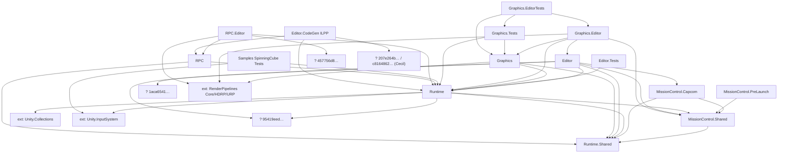

# Migration Progress – Unity Cluster Display

Stand der Erstanalyse: 2026-10-08 (Branch `dotnet-update`). Gemeinsames Gedächtnis zwischen Sessions – nach jedem Task Status, Messwerte und Commit eintragen.

## Stand 2026-10-12 Abend: Zwei-Rechner-Test PC + Laptop (WLAN), offen

**Aufbau:** PC (192.168.1.102, "Ethernet 2", RTX 5070 Ti, D3D12) + Laptop (192.168.1.106, nur WLAN, GTX 1050, D3D11). Testinstallation `H:\Projekt\_mc_test` (Kit für den Laptop: `laptop-kit\`). Laptop als zweiter Launch Complex mit eigener HangarBay/LaunchPad eingebunden; Build wird über die HangarBay auf den Laptop übertragen und gestartet (belegt).

**Problem:** Der Cluster kommt nicht zustande. Der Handshake scheitert: Pakete des **Laptop-Players** (Multicast, WLAN) erreichen den PC nie, in beiden Rollen (Laptop als Repeater: `InvalidDataException ... Frame 1 ... expecting frame 0`; Laptop als Emitter: PC-Repeater `TimeoutException`). PC → Laptop funktioniert (Laptop-Emitter bekam 154 Registrierungen).

**Belegt/ausgeschlossen (alle mit Messung):** rohe Multicast-Tests Laptop → PC kommen an (auch gebunden an die Adapter-IP, Quellport 25690, TTL 1, `ReuseAddress`; nur die ersten Sekunden gehen verloren). Nicht die Ursache: PC-Firewall (Regel vorhanden, keine Block-Regel), Handshake-Zeit (40 s ändert nichts), Quellport/Bindung, PC-Standardroute. Fehlerbild im Player tritt nur bei Paketen des Laptop-**Players** auf.

**Code-Befund (lokal, nicht committet):** `UDPAgent.cs` trat der Multicast-Gruppe ohne Adapter bei (`JoinMulticastGroup(ip)`) → Windows nimmt den Adapter mit der besten Multicast-Route, auf dem Laptop sind das virtuelle Adapter (WLAN hat dort die schlechteste Metrik 291). Geändert auf `JoinMulticastGroup(ip, AdapterAddress)`. **Allein hat das den Fehler nicht behoben** (Lauf mit neuem Build, PC-Repeater Recv = 0). Fix bleibt sinnvoll, Commit erst nach Klärung.

**Nächster Schritt (offen):** Auf dem Laptop `Set-NetIPInterface -InterfaceAlias WLAN -AddressFamily IPv4 -InterfaceMetric 1` (Admin) und Cluster erneut starten, danach zurücksetzen (`-AutomaticMetric Enabled`). Prüft, ob der Player (Mono) auf dem Laptop den gewählten Adapter beim Senden ignoriert (`SetSocketOption(IP, MulticastInterface, byte[])`). Falls nein: LAN-Kabel am Laptop (Zielumgebung ist verkabelt), `netlog`-Build (`CLUSTER_DISPLAY_NETWORK_LOG`, `Standalone:` in `scriptingDefineSymbols`) auf beiden Seiten vergleichen.

**Zusätzlich offen:** `MissionControlSystem/Package.ps1` (deps.json nicht mehr ausschließen) ist geändert, aber nicht committet. Einzelknoten-Starts werden nach 15 s hart beendet (keine Capsule, Design-Eigenheit). Rollen lassen sich pro Launchpad in der UI setzen (Parameter `NodeRole`), die Komplexe sind nach Hangar-Bay-ID sortiert.

## Stand 2026-10-09 (Zusammenfassung für den Wiedereinstieg)

**Gemessen mit Editor 6000.3.13f1 (Mono, Windows 11, RTX 5070 Ti):** alle 9 Projekte kompilieren mit 0 Fehlern; Obsolete nur noch `ClusterSerialization` ×2 (Zeit-Sync, siehe M-42). Tests:

| Suite | Ergebnis |
|---|---|
| ClusterSyncTests PlayMode | 209/212 grün (3 übersprungen: Quadro-DLL, 2× Windows-Input) |
| RPCTests PlayMode | 14/14 |
| MissionControlTests EditMode | 274/274 |
| GraphicsTestsHDRP PlayMode (GPU) | 50/50 |
| GraphicsTestsURP PlayMode (GPU) | 44/44 – **ohne** URP Compatibility Mode (vorher 10/43) |
| GraphicsTestsURP/HDRP EditMode | je 17/17 |
| .NET `MissionControl.sln -m:1` | 595 bestanden, 0 Fehler |
| Player-Build + Zwei-Node-Smoke (Emitter+Repeater, Multicast) | läuft stabil; Zeit-Sync-Vergleich 43 Stichproben |

**Gelöst:** MissionControl lehnte Builds ab, weil git die eingecheckten Builds verändert hat (CRLF) – frischer Build wird akzeptiert (M-03/M-04). URP-Present auf Render Graph (M-31..33). Protokoll mit Magic+Version, MTU-Fix (M-43). Optionaler Zeit-Sync ohne `ClusterSerialization` (M-42). Mehrere echte Produktfehler gefunden und behoben (Locale-abhängige Zahlen, tote Shader-Strip-Prüfung, Play-Mode-Reset, NRE ohne Mission Control, nicht antwortende LaunchPads, …).

**Entscheidungen / Aufgaben für dich (Montag):**
1. **Push**: `dotnet-update` ist lokal weit vor `github.com/dotnet-update` (nichts gepusht seit dem ersten Push).
2. **Manuell**: im Web-UI einen Build registrieren und auf einem LaunchPad starten (Rest von M-04); Zwei-/Mehr-Rechner-Test im echten Netz; Sichtprüfung der Kachelausgabe auf echten Displays.
3. **Zeit-Sync-Default** (M-42): `FixedStep` ist optional (`-timeSync fixedStep`); vor einer Umstellung prüfen: `Time.unscaledTime` ist nicht synchron, Zeitlupe bei langsamen Frames, `-targetFps` = Display-Refresh, >2 Nodes + Failover testen.
4. **Hardware** (Quadro/RTX PRO Sync): M-61 (Plugin-Neubau, Header sind aktualisiert, kompiliert), M-63/M-64 (Tests), M-65 (Doku).
5. **CI** (M-05): Unity-Workflow braucht Lizenz-Secrets + Variable `UNITY_CI=true`.
6. **Release**: Version 0.2.0 (M-70), 6.7 LTS/CoreCLR (M-72, inkl. M-22/M-62), RPC-Strategie (M-52).
7. Ziel-Patchlevel 6000.3.26f1 (installiert ist 13f1).

**Bekannte offene Beobachtungen:** Unity-Shutdown-Segfault in ~1 von 3 ClusterSyncTests-Läufen (Ergebnisse vollständig; `run_tests.sh` meldet nur Warnung); schwankende Testanzahl in ClusterSyncTests (218 → 206 ohne Codeänderung, pro Klasse konsistent).

**Skripte** (`.claude/skills/unity-compile-check/scripts/`): `check_compile.sh`, `run_tests.sh`, `gfx_tests.sh` (mit GPU), `build_player.sh` (mit Watchdog), `two_node_smoke.sh`. Alle mit Timeout – Unity nie ohne Zeitlimit starten.

## Ausgangslage
- Unity: alt 2023.1 (Package-Minimum) / Testprojekte 2020.1 … 6000.2.8f1 → Ziel **6000.3.26f1 LTS** → danach Folgemeilenstein **6.7 LTS** (derzeit nicht installiert). 6.0 LTS endet 2026-10-16.
- Compile-Baseline (2026-10-08, Editor **6000.3.13f1**, voller Compile): `pfcClusterBasicTestURP` (URP) **0 Fehler / 9 Obsolete / 10 Warnungen**; `GraphicsDemoProject` (HDRP) **0 Fehler / 15 Obsolete / 15 Warnungen** (davon 6 in Package-Tests, 1 im Demo-Projekt). Ziel-Patchlevel 6000.3.26f1 nicht installiert.
  - Aus den vorhandenen Bee-Logs von `TestProjects/pfcClusterBasicTestURP` (6000.2.8f1, URP 17.2): 0 Fehler; Warnungen u. a. CS0618 `ClusterSerialization` (`ClusterSync.cs`, `EmitterStateWriter.cs`, `RepeaterStateReader.cs`), `ScriptableRenderPass.Execute` (`InjectionPointRenderFeature.cs`), `cameraColorTargetHandle` (`UrpPresenter.cs`), `FindObjectsOfType` (3 Stellen), `renderPipelineAsset` (`UrpUtility.cs`).
- Render Pipelines: URP (`pfcClusterBasicTestURP`, `GraphicsTestsURP`) und HDRP (`GraphicsDemoProject`, `GraphicsTestsHDRP`); `pfcClusterBasicTestURP` läuft mit `m_EnableRenderCompatibilityMode: 1`.
- Netzwerk-Stack (Ist): **eigenes UDP** (`System.Net.Sockets`), kein UNet/Unity Transport: `Runtime/Networking/UDPAgent.cs` (+ `FrameDataAssembler`, `FrameDataSplitter`), `Runtime/Node/{Emitter,Repeater}Node.cs`, `Runtime/Scripting/EditorLink.cs`; MissionControl/Capsule/Capcom nutzen ebenfalls Sockets (außerhalb Frame-Sync-Pfad).
- Scripting-Backend: Mono, Windows x64, D3D11/D3D12.
- Packages: `com.unity.cluster-display`, `.graphics`, `.rpc` (alle `0.1.0-preview`, `unity: 2023.1`); `GfxPluginQuadroSync` (C++/NvAPI, Binary eingecheckt); `MissionControlSystem` (.NET 8, Blazor); 15 `.asmdef` in `source/`.
- Grep-Inventar `source/*.cs` (Dateien / Treffer): `FindObjectsOfType|FindObjectOfType` 8/10 · `GraphicsSettings.renderPipelineAsset` 1/1 · `ClusterSerialization` 3/5 · `AppDomain.CurrentDomain.GetAssemblies` 6/7 · `Shader.Find` 3/3 · `RenderPipelineManager` 1/3 · `UnityEngine.Input`/`Input.Get*`, `OnRenderImage`, `onPreRender`, `Experimental.LowLevel`: **0** (Standardfälle der Skills treffen kaum zu).
- Testprojekte (`ProjectVersion.txt`): 6000.2.8f1 `GraphicsDemoProject`, `pfcClusterBasicTestURP`; 2022.3.62f2 `ClusterRenderTest`, `ClusterSyncTests`, `GraphicsTestsURP`, `RPCTests`; 2023.1 alpha/beta `GraphicsTestsHDRP`, `LiveEditingTests`; 2022.2 Beta (tot) `MissionControlTests`, `Mosys`, `VirtualCameraTest` (Manifeste zeigen auf nicht existierenden Pfad `../../../MissionControl/…`).

## Assembly-Abhängigkeiten
Aus den `.asmdef`-Referenzen (GUIDs aufgelöst, soweit im Repo/PackageCache auffindbar). **Keine Zyklen.** `ext:` = Unity-Package; „?“ = GUID nicht aufgelöst (Task M-10).

Auffälligkeiten: viele Referenzen per GUID statt Name (schlecht lesbar, M-10); `Graphics` referenziert HDRP **und** URP gleichzeitig (Define-Steuerung `CLUSTER_DISPLAY_HDRP/URP` über `versionDefines`); alle Runtime-asmdefs auf `Editor`+`WindowsStandalone64` beschränkt; `Capcom`/`PreLaunch` `noEngineReferences`.

## Entscheidungen
| Datum | Entscheidung | Begründung | Offen? |
|---|---|---|---|
| 2026-10-08 | **Modernisieren, kein Rewrite** | Kern (UDP-Lockstep, Statemaschine, Failover, Projection-Math, ~8k Zeilen Tests) kompiliert bereits unter 6000.2; nur URP-Present, Zeit-Sync und Teile von RPC erzwingen Neubau. Konzept (NVIDIA Frame-Lock + Swap-Barrier) ist weiter Stand der Technik (nDisplay, TouchDesigner, Pixera). | – |
| 2026-10-08 | E-01 Ziel **6000.3.26f1 LTS**; **6.7 LTS als Folgemeilenstein** (M-72) | 6.0 LTS endet 2026-10-16; 6.7 derzeit nicht installiert (letzte Mono-Version, vor Unity 7/CoreCLR). | – |
| 2026-10-08 | E-02 Transport bleibt eigenes UDP (Emitter/Repeater, Multicast). **Keine Rückwärtskompatibilität zu alten Protokollständen nötig**, nur Lauffähigkeit mit 6.3; Wire-Format darf sich ändern, aber nur mit erhöhter Protokollversion (CLAUDE.md Regel 4). | Nutzerentscheidung; kein UNet/Unity-Transport-Austausch nötig. | – |
| 2026-10-08 | E-08 Tote Testprojekte (`Mosys`, `VirtualCameraTest`, `MissionControlTests`): **reparieren, wenn sinnvoll**, sonst entfernen (Bewertung pro Projekt in M-12). | Nutzerentscheidung. | – |
| 2026-10-08 | E-03 Mono-Only auf Windows-Standalone; CoreCLR/IL2CPP-Fitness später (M-72). | Mono bis 6.7 Default/unterstützt; Capcom-Suche und Delegates sind Mono-gebunden; IL2CPP laut Doku „currently broken“. | – |
| 2026-10-08 | E-04 RPC bleibt Feature: kurzfristig ILPP + Mono.Cecil 1.11.5; mittelfristig Generator-Spike (C# 9, nur additiver Code). | Ziel großes Rendercluster nutzt RPC; ILPP/Cecil „unsupported“, wird aber von NGO/Mirror weiter genutzt. | Spike M-52 |
| 2026-10-08 | E-05 Ersatz für `ClusterSerialization` Time-State: fester Takt (`Time.captureDeltaTimeRational`) + Random-Seed (`Random.state` setzbar) + `ClusterTime`-Abstraktion; PlayableDirector manuell evaluieren. | Klasse `[Obsolete]`, keine Alternative, Entfernung „future release“ (evtl. Unity 7); keine öffentliche API zum Setzen von `Time.time`. | Spike M-41 |
| 2026-10-09 | E-06 (revidiert) URP-Renderpfad: **Forward und Forward+ beide getestet und unauffällig** (siehe M-37); die ursprüngliche Vorsicht („nicht Forward+“) ist durch den Test `TiledProjectionPointLightsTest` entkräftet, bleibt aber als Regressionstest. Ursprünglich: Forward/Deferred, nicht Forward+. | Forward+ mit eigener Projektionsmatrix: Point-Light-Fehler, Unity „Won't Fix“ (Forum, 2024). | bestätigen in M-37 |
| 2026-10-08 | E-07 Quadro: erst DX11, dann DX12; Hardware RTX PRO Sync (Nachfolger Quadro Sync II) + RTX 6000 Ada/RTX PRO 6000 Blackwell (keine GeForce). | DX12 ist seit Unity 6.1 Default; Plugin nutzt `IUnityGraphicsD3D12v7`/`NvAPI_D3D1x_*`; Hook-Bestand in 6.3 ungeprüft. | Hardware-Beschaffung |
| 2026-10-08 | E-09 URP-Present wird als Render-Graph-Pass neu gebaut (`RecordRenderGraph`), HDRP-Pfad wird beibehalten. | URP Compatibility Mode in 6.3 ausgeblendet, in 6.4 für Custom Passes entfernt; HDRP-APIs nicht obsolet (HDRP im Wartungsmodus). | Spike M-30 |
| 2026-10-08 | E-10 Hypothese „Builds abgelehnt“: MD5-Mismatch im `LaunchCatalog.json` (CRLF/LF durch `core.autocrlf=true`, 20/176 Dateien in `pfcClusterBasicTestURP/builds/01`). | Server berechnet MD5 neu und lehnt bei einem Mismatch den Katalog ab (HTTP 400). Nicht live verifiziert. | Repro in M-04 |
| 2026-10-08 | Vorerst Editor **6000.3.13f1** (`D:\Program Files\Unity\Hub\6000.3.13f1\Editor\Unity.exe`) für M-02 ff. | Nutzerentscheidung; 6000.3.26f1 nicht installiert. `ProjectVersion.txt` bei M-02 auf 6000.3.13f1 heben, Patchlevel später angleichen. | Patchlevel 26f1 |
| 2026-10-13 | E-11 Zeit-Sync-Standard bleibt **Engine-Zustand** (`TimeSync.EngineState`); fester Takt (`TimeSync.FixedStep`) bleibt optional, eine andere Lösung wird bei Bedarf erwogen. | Nutzerentscheidung im Teammeeting; entscheidet die offene Frage aus der Montags-Agenda. Standard war ohnehin unverändert. |
| 2026-10-13 | E-12 Mehr-Rechner-Tests laufen vorerst weiter über **WLAN** (kein Kabel/Switch verfügbar). | Nutzerentscheidung; Folge: Handshake-Probleme auf WLAN-Multicast sind einzuplanen, Zielumgebung bleibt verkabelt. |
| 2026-10-13 | E-13 Quadro/RTX-PRO-Sync-Hardware kann derzeit **nicht beschafft** werden; ein **Forschungspartner mit Hardware** wäre bereit zu testen (M-63/M-64/M-65 über Partner). | Nutzer: Beschaffung nicht möglich. Voraussetzung: lauffähiges Test-Paket (Player-Build, Anleitung, Messprotokoll), noch zu erstellen. |

## Backlog
Status: `[ ]` offen · `[~]` in Arbeit · `[x]` erledigt · `[-]` aufgeteilt · `[manuell]` Hardware-/Installations-Prüfung durch Nutzer

| ID | Status | Modul | Aufgabe | Abhängig von | Skill | Abnahme |
|---|---|---|---|---|---|---|
| **Block 0 – Setup & Baseline** |
| M-00 | [x] | Doku | `CLAUDE.md` Projektfakten bereinigen (Zielversion, Compile-Projekt, Netzwerk-Stack, Pipelines) | – | – | Keine Platzhalter/TODO mehr |
| M-01 | [x] | Setup | Unity-Editor bereitgestellt: **6000.3.13f1** (UNITY_PATH-Export genügt; Patchlevel 26f1 optional später) (`D:\Program Files\Unity\Hub\6000.3.13f1\Editor\Unity.exe`), Ziel-Patchlevel 6000.3.26f1 offen; `UNITY_PATH` setzen | – | unity-compile-check | `check_compile.sh` Exit ≠ 2 |
| M-02 | [x] | Build | Beide Compile-Projekte (`pfcClusterBasicTestURP`, `GraphicsDemoProject`) auf 6000.3.13f1 gehoben (2026-10-08; 26f1 nicht installiert) (nur `ProjectVersion.txt` + Manifest, API-Updater-Diff separat committen), Baseline messen | M-01 | unity-compile-check | Fehler/Obsolete/Warnungen im Log eingetragen |
| M-03 | [x] | Repo | Hygiene (2026-10-08, gestaged, nicht committet): `MissionControlSystem/{0001,_ouput}`, `*.zip` aus Git, `builds/` neu erzeugen/LFS, `.gitattributes` (`TestProjects/**/builds/** -text`), `.gitignore` (`Out/`, `UI/`) | – | – | Repo-Größe sinkt, `git status` sauber |
| M-04 | [x] | MissionControl | Build-Akzeptanz (erledigt 2026-10-09; frischer Unity-6.3-Build wird importiert; nur Web-UI-Klick + Launch auf LaunchPad bleibt `[manuell]`): Repro mit frischem Unity-Build (Instrument an, Mono), Fehlertext sichern; Fix; Regressionstests (CRLF/LF-MD5, Altformat `launchEntries`, fehlender Katalog); bessere Fehlermeldung (Datei+Hash); Upload-Timeout prüfen (`AssetsService.cs:43`); Path-Traversal-Schutz (`FileAssetSource.cs:38`) | – | – | `dotnet test MissionControlSystem/MissionControl.sln` grün; E2E Build→UI→Launch `[manuell]` |
| M-05 | [~] | CI | `.github/workflows/mission-control-ci.yml`: .NET 8, `checkout@v4`, Branch klären; Unity-Test-Job (GameCI) | M-01, M-10 | unity-compile-check | Workflow grün |
| M-05b | [x] | CI | Vorbestehende Rotläufer beseitigen, damit CI aussagekräftig ist: `LaunchPadsHealthControllerTests.UpdateError`, `MissionControl.Shared.Tests` `DefaultValueGood` ×2 (Locale), Gesamtlauf `LaunchPad.Tests`/`HangarBay.Tests` einzeln gegen HEAD prüfen | M-05 | – | `dotnet test MissionControl.sln` grün (ggf. Tests mit `CultureInfo.InvariantCulture` reparieren) |
| **Block 1 – Compile-Blocker** |
| M-10 | [x] | Packages | `package.json` ×3: `unity: 6000.3`, Abhängigkeiten (collections 2.x, newtonsoft aktuell, Input System, mono-cecil → M-50), asmdef-GUID-Referenzen auf Namen, tote `InternalsVisibleTo` (`AssemblyInfo.cs`) | M-02 | unity-compile-check | 0 Fehler in beiden Compile-Projekten |
| M-11 | [x] | Testprojekte | `ClusterSyncTests`, `RPCTests`, `GraphicsTestsURP`, `GraphicsTestsHDRP`, `LiveEditingTests`, `ClusterRenderTest` auf 6000.3 | M-10 | unity-compile-check | je 0 Fehler |
| M-12 | [x] | Testprojekte | **`LiveEditingTests` (Paket `com.unity.live-editing` existiert nicht mehr → entfernen)**, `MissionControlTests`, `Mosys`, `VirtualCameraTest`: Manifest-Pfade reparieren, hochziehen; sonst entfernen (E-08) | M-10 | unity-compile-check | Manifest löst auf, 0 Fehler – oder Projekt entfernt |
| **Block 2 – Obsolete-APIs** |
| M-20 | [x] | Core/Graphics | `FindObjectsOfType/FindObjectOfType` → `FindObjectsByType/FindFirstObjectByType` (8 Dateien, u. a. `SingletonMonoBehaviour.cs`, `SceneSingletonMonoBehaviour.cs`, `ClusterDisplayGraphicsSetup.cs`); bei >4 Dateien aufteilen | M-10 | unity-api-migration | Obsolete −10 Treffer, 0 Fehler |
| M-21 | [x] | Graphics.Editor | `GraphicsSettings.renderPipelineAsset` → `currentRenderPipeline` (`UrpUtility.cs:16,100`) | M-10 | unity-api-migration | 0 Fehler, Warnung weg |
| M-22 | [-] | Core/RPC | **Zurückgestellt → M-72 (Unity 6.7):** `UnityEngine.Assemblies.CurrentAssemblies` ist in 6000.3.13f1 `internal` (CS0122), `AppDomain.GetAssemblies()` ist unter Mono und in 6.3 weiterhin korrekt und ohne Obsolete-Warnung. Ursprüngliche Aufgabe: `AppDomain.CurrentDomain.GetAssemblies()` → `UnityEngine.Assemblies.CurrentAssemblies` (RPC `ReflectionAssembly*Utils`, `RPCSerializer`, `AttributeUtility.cs:63`); **Capcom ausgenommen** (läuft außerhalb Unity) | M-10 | unity-api-migration | 0 Fehler, RPCTests grün |
| M-23 | [-] | Graphics | **Entfällt als Migration:** `Shader.Find` ist nicht obsolet; das Paket nutzt bewusst „Always Included Shaders“ + `EnsureShadersIncluded` (Editor). Umbau auf serialisierte Referenzen wäre ein Redesign → bei Build-Stripping-Problemen in M-71 neu bewerten. Nur Null-Prüfung in `MeshWarpProjection` ergänzt. Ursprünglich: `Shader.Find` (`GraphicsUtil.cs`, `MeshWarpProjection.cs`, …) → serialisierte Referenzen/Resources | M-10 | unity-api-migration | Build-Strip-sicher, Bildtests grün |
| M-24 | [x] | Graphics | `using UnityEditor` ungeschützt in Runtime (`TiledProjection.cs`, `ClusterReplication.cs`) guarden | M-10 | unity-api-migration | Player-Build kompiliert |
| M-25 | [x] | Core | Legacy-Input-Pfad entfernen (`InputSync.Legacy`, `ClusterSerialization.*InputManagerState`, `ClusterSync.cs:306/326/346`, Settings/Docs) | M-10 | cluster-sync-network | 0 Fehler, ClusterSerialization-Treffer −3 |
| M-26 | [x] | alle | Obsolete-Rest: `list_obsolete.sh` auswerten, Folgetasks ableiten (kein `#pragma warning disable`) | M-20…M-25 | unity-compile-check | Obsolete = 0 außer `ClusterSerialization` Time-State (bis M-42) |
| **Block 3 – Rendering (URP/HDRP)** |
| M-30 | [x] | Graphics | **Spike:** URP Render Graph – Tile-Rendering, `useScreenCoordOverride`, asymmetrische Projektion, Post-Effekte; Ergebnis dokumentieren, ggf. M-31/32 aufteilen | M-02 | unity-api-migration | Spike-Bericht in Entscheidungen (E-09) |
| M-31 | [x] | Graphics | `InjectionPointRenderFeature`: `Execute(ref RenderingData)` → `RecordRenderGraph` (`AddRenderPasses`, `UniversalResourceData`) | M-30 | unity-api-migration | CS0618 `Execute` weg |
| M-32 | [x] | Graphics | **Dringend:** in 6000.3.13f1 meldet `cameraColorTargetHandle` "will do nothing" (Compatibility Mode versteckt hinter `URP_COMPATIBILITY_MODE`) → URP-Present ist schon in 6.3 funktionslos. `UrpPresenter`: `cameraColorTargetHandle` → `backBufferColor`/`AddBlitPass` | M-31 | unity-api-migration | Warnung weg, Bild korrekt |
| M-33 | [x] | TestProjects | `pfcClusterBasicTestURP`: Compatibility Mode aus (`m_EnableRenderCompatibilityMode: 0`), Bildtests `ImageAssert` (Tile-Naht, Overscan, Post-Effekte) | M-32 | unity-compile-check | `GraphicsTestsURP` PlayMode grün |
| M-34 | [x] | Graphics | **Spike:** `Camera.Render()` vs `SubmitRenderRequest` in `CameraScopeFactory.cs` (Stabilität, History/Temporal, viele Tiles) | M-30 | unity-api-migration | Entscheidung dokumentiert |
| M-35 | [x] | Graphics | HDRP-Presenter (`customRender`, FrameSettings `AsymmetricProjection`/`ScreenCoordOverride`) auf 6000.3 verifizieren | M-02 | unity-compile-check | `GraphicsTestsHDRP` grün |
| M-36 | [x] | Graphics.Editor | Reflection auf Unity-Interna ersetzen (`UrpUtility` `m_RendererDataList`, `ShaderPreprocessor`, `EnsureShadersIncluded`, `LiveCaptureConnectionBridge`) | M-21 | unity-api-migration | Keine NonPublic-Reflection auf SRP-Typen |
| M-37 | [x] | Graphics | Renderpfad Forward/Deferred festschreiben (E-06) + Test mit Off-Axis-Frustum und Point Lights | M-33 | – | Bildtest grün, kein Forward+ |
| **Block 4 – Sync/Netzwerk/Zeit** (Regeln: kein async im Frame-Sync-Pfad, Wire-Format nur mit Protokollversion, keine Unity-API aus Threads) |
| M-40 | [x] | Core | Static-Resets für Enter-Play-Mode ohne Domain Reload (`ClusterSyncLooper`-Events, `ServiceLocator`, State-Writer/Reader-Registries, `ClusterSync`-Events) | M-10 | cluster-sync-network | Play-Mode 2× ohne Reload ohne Doppelregistrierung (Test) |
| M-41 | [x] | Core | **Spike:** Zeit-Sync ohne `ClusterSerialization` (`captureDeltaTimeRational`, Seed, `ClusterTime`); Drift über ≥10 min messen | M-40 | cluster-sync-network | Spike-Bericht; `[manuell]` Mehrnode-Messung |
| M-42 | [~] | Core | Umsetzung Zeit-Sync-Ersatz (`EmitterStateWriter.cs:25`, `RepeaterStateReader.cs:20`), Protokollversion erhöhen | M-41 | cluster-sync-network | `ClusterSerialization`-Treffer = 0, Roundtrip-Tests grün |
| M-43 | [x] | Core | Protokollversion/Handshake-Policy dokumentieren (E-02) + Roundtrip-/Fragmentierungstests (`FrameDataAssembler`) | M-42 | cluster-sync-network | Doku + Tests grün |
| M-43a | [x] | Core | **Protokoll-Header einführen (Magic + Protokollversion, optional Cluster-ID)** – aktuell hat ein Datagramm nur 1 Byte `MessageType`; Wire-Änderungen sind nicht erkennbar (siehe `.claude/skills/cluster-sync-network/references/current-protocol.md`). Repeater mit falscher Version verwirft laut und einmalig | M-43 | cluster-sync-network | Roundtrip-/Versionstests grün, ClusterSyncTests grün |
| M-43b | [x] | Core | **MTU-Fehler:** `MaximumMessageSize = Mtu-1` zieht 28 Byte IP-/UDP-Header nicht ab (`UDPAgent.cs:89`) → volle `FrameData`-Fragmente werden bei MTU 1500 IP-fragmentiert. Korrigieren + Fragmentierungstest | M-43 | cluster-sync-network | Test: kein Datagramm > MTU-28, Roundtrip großer Frames |
| M-44 | [ ] | Tests | `ClusterSyncTests` (8k LOC, `TestUdpAgent`) ins Package `source/com.unity.cluster-display/Tests`, in CI | M-11, M-05 | unity-compile-check | EditMode grün in CI |
| M-45 | [-] | Core | **Kein Handlungsbedarf / API-Limit:** die Allokation steckt in Unitys `InputEventTrace.ReadFrom(Stream)` (kein Unmanaged-Byte-API, im Code bereits dokumentiert); Replay mit Input System 1.19 funktioniert, die `InputSystem`-Tests in ClusterSyncTests sind grün (PlayMode 215/218). Bei Bedarf später messen (GC-Profiler im Replay), nicht jetzt. Ursprünglich: `InputSystemReplicator`: Allokationen (FIXME `ReadFrom`), Replay-Test mit Input System 1.20.x | M-25 | cluster-sync-network | `InputSystemTests` grün, 0 GC im Replay |
| M-46 | [-] | Core/RPC | **Entfällt (Prämisse falsch):** die beiden `PlayerLoopExtensions` sind keine Duplikate – Core (`Utils`) bietet `RegisterUpdate`/`DeregisterUpdate`, RPC (`Unity.ClusterDisplay.RPC`) bietet `InsertBefore`/`InsertAfter`/`RemovePlayerLoops`, nur der Klassenname gleicht sich; Deregistrierung erfolgt in `ClusterSync.CleanUp` über `RemoveSynchPointFromPlayerLoop`. Ursprünglich: `PlayerLoopExtensions` (Core + RPC) zusammenführen, saubere Deregistrierung | M-40 | cluster-sync-network | Ein Typ, Tests grün |
| **Block 5 – RPC** |
| M-50 | [x] | RPC | `com.unity.nuget.mono-cecil` 1.10.1 → 1.11.5, ILPP unter 6000.3 bauen | M-10 | unity-api-migration | 0 Fehler, ILPP läuft |
| M-51 | [x] | RPC | `RPCTests` auf 6000.3 (EditMode/PlayMode) | M-50, M-11 | unity-compile-check | grün |
| M-52 | [ ] | RPC | **Spike:** Source-Generator (C# 9, partial) vs. ILPP vs. Reflection-Registry; Entscheidung E-04 | M-51 | – | Bericht + Entscheidung |
| **Block 6 – Quadro Sync** |
| M-60 | [x] | Plugin | 6000.3-Header prüfen (`Editor\Data\PluginAPI\IUnityGraphicsD3D12.h`: Version?, `kUnityRenderingExtQueryOverridePresentFrame`) | M-01 | – | Ergebnis in Entscheidungen |
| M-61 | [~] | Plugin | `GfxPluginQuadroSync` mit aktueller Toolchain/Header neu bauen; Binary-Policy (Release/LFS statt Repo) | M-60 | – | DLL baut, lädt in Unity |
| M-62 | [-] | Core | **Zurückgestellt → M-72:** nur für IL2CPP/CoreCLR relevant, Plattform ist Mono-only (E-03), unter Mono funktioniert `Marshal.GetFunctionPointerForDelegate` auf einem `Func<>`. Ursprünglich: `Marshal.GetFunctionPointerForDelegate<Func<>>` → `[MonoPInvokeCallback]`/Function Pointer (`GfxPluginQuadroSyncSystem.cs:175`); `CommandBuffer` freigeben | M-10 | unity-api-migration | Kompiliert, Quadro-Editor-Tests grün |
| M-63 | [manuell] | Plugin | DX11-Hardwaretest (RTX PRO Sync, ≥2 Nodes) | M-61, E-07 | – | Kein Tearing/Versatz (Testmuster) |
| M-64 | [manuell] | Plugin | DX12-Hardwaretest (Swap Group, `maxQueuedFrames`, ggf. Present-Barrier-API) | M-63 | – | wie M-63 auf DX12 |
| M-65 | [~] | Doku | `quadro-sync.md` aktualisieren (RTX PRO Sync, Windows 11, Treiber/Firmware) | M-63 | – | Doku aktuell |
| **Block 7 – Release** |
| M-70 | [~] | Doku | README/CHANGELOG/Documentation~ (Unity 6.3, Windows 11, .NET 8), Version 0.2.0 | M-26 | – | Docs konsistent |
| M-71 | [manuell] | QA | Smoke-Matrix HDRP/URP × DX11/DX12, 2-Node-Lauf | M-33, M-35, M-42 | – | Matrix grün |
| M-72 | [ ] | Meilenstein | **6.7 LTS** (inkl. M-22: `AppDomain.GetAssemblies` → `CurrentAssemblies`) (nach Installation) + CoreCLR-Vorbereitung (`Assembly.Location`, AppDomain, Marshal, MissionControl-Capcom) | M-71 | unity-api-migration | Neuer Backlog-Abschnitt 6.7 |

## Log
| Datum | ID | Ergebnis (Fehler / Obsolete / Tests) | Commit | Notizen |
|---|---|---|---|---|
| 2026-10-08 | – | Erstanalyse (read-only), keine Messung | – | Editor 6000.3.26f1 nicht installiert; Zahlen aus Bee-Logs/Grep |
| 2026-10-08 | M-03 | n/a (kein Unity) | – (gestaged, nicht committet) | 1582 Dateien aus dem Index (`0001/`, `_ouput/`, 4 zips, `TestProjects/pfcClusterBasicTestURP/builds/`), bleiben auf der Platte; `.gitignore` + `.gitattributes` (`builds/** -text`) ergänzt |
| 2026-10-08 | M-04 | .NET: `AssetsAcceptanceTests` 8 neu, Assets-/Controller-/IncrementalCollections-Tests 49/49 grün; `MissionControl.Tests` gesamt 362/363 | – (nicht committet) | Ursache bestätigt: 20/176 Dateien in `builds/01` weichen vom Katalog-MD5 ab (16× exakt CRLF statt LF, 4× von git anders verändert: `Compat.browser`×3, `browscap.ini`). Fix: Dateiname + Zeilenenden-Hinweis in der Fehlermeldung, Altformat-Katalog wird abgelehnt (statt leer akzeptiert), Path-Traversal-Schutz, ungültiger MD5-String, HttpClient-Timeout 30 min. Vorbestehende Fehler (auch auf HEAD): `LaunchPadsHealthControllerTests.UpdateError`, `MissionControl.Shared.Tests` `DefaultValueGood` ×2 (Locale) |
| 2026-10-08 | M-02 | URP 0 Fehler / 9 Obsolete / 10 Warnungen; HDRP 0 / 15 / 15 (voller Compile, Editor 6000.3.13f1) | siehe Commits "Restore Samples~" und "M-02" | Beide Projekte via Unity-Batchmode auf 6000.3.13f1 migriert (Manifest/Settings-Änderungen = Unity-Upgrade, separat committet). Erster HDRP-Lauf: 1 Fehler `CS0234` in `Samples/SpinningCube/Scripts/CycleMaterialOnKey.cs` (Input System fehlt): die Umbenennung `Samples~` → `Samples` vom Heim-PC machte das Sample zu normalem Package-Code und widerspricht `package.json` (`Samples~/SpinningCube`) → Umbenennung rückgängig gemacht. Obsolete-Treffer: `ClusterSerialization` (5), `FindObjectsOfType` (3), `cameraColorTargetHandle` (1, "will do nothing"), Rest in Tests/Demo |
| 2026-10-08 | M-02 (Nachtrag) | – | – | Unity-Upgrade legte `TestProjects/GraphicsDemoProject/Assets/HDRPDefaultResources/HDRenderPipelineGlobalSettings 1.asset` an (Duplikat des vorhandenen Assets; unklar, ob `GraphicsSettings.asset` es referenziert, da Binärformat). Sicherheitshalber mitcommittet → Aufräumkandidat, sobald im Editor geprüft |
| 2026-10-08 | M-05 | nicht auf GitHub ausgeführt | – | `mission-control-ci.yml`: .NET 8, `checkout@v4`/`setup-dotnet@v4`, Branches `main`/`dotnet-update`/`dev`. Neu `unity-compile.yml` (GameCI `unity-test-runner@v4`, Unity 6000.3.13f1, URP+HDRP-Matrix), läuft nur mit Repository-Variable `UNITY_CI=true` und Lizenz-Secrets → braucht Einrichtung durch Nutzer `[manuell]`. Bekannt: .NET-CI bleibt rot, bis M-05b erledigt |
| 2026-10-09 | M-05b | .NET `dotnet test MissionControl.sln -m:1`: HangarBay 67/67, LaunchPad 57/57, Shared 108/108, MissionControl.Tests 362/363; Unity URP 0/9, HDRP 0/15 unverändert | siehe Commit "M-05b" | Echte Produktfehler gefunden (nicht nur Tests): (1) `Convert.To*` ohne Culture in Parameter-/Konfigurationslogik → auf deutscher Locale wurde "42.28" als 4228 gelesen, `appsettings`-Werte wie `0.5` falsch → überall `InvariantCulture` (Unity-Quellen **und** die parallele .NET-Implementierung in `MissionControl.Shared`), Regressionstests `CultureIndependenceTests` (`de-DE`). (2) LaunchPad-CPU-Health lieferte auf deutschem Windows -1 (Counter `\Processor(_Total)…` ist lokalisiert) → `PdhAddEnglishCounter`. Wichtig: Tests nur mit `-m:1` ausführen (parallele Test-Projekte kollidieren auf Ports, sonst Dutzende Fehlschläge). **Offen:** `LaunchPadsHealthControllerTests.UpdateError` (Windows-`HttpListener`-Stub, Timing, schon vor unseren Änderungen rot) |
| 2026-10-09 | M-10 | URP 0/9/10, HDRP 0/15/15 (voller Compile, unverändert) | siehe Commit "M-10" | `package.json` ×3: `unity: 6000.3`; Core: `collections 2.6.5`, `newtonsoft-json 3.2.2` (= was Unity 6.3 ohnehin auflöst), **neu `com.unity.inputsystem 1.14.0`** (war harte asmdef-Referenz ohne Deklaration). 10 GUID-Referenzen durch Assembly-Namen ersetzt. Tote `InternalsVisibleTo` entfernt (`Graphics.Example`, `Helpers`, `Helpers.Editor`, `Samples`, `Samples.Editor`, `RPC.Runtime`); `GeneratedWrappers`/`Inspectors.Generated` bleiben (mögliche generierte Assemblies). **Offen:** 4 GUID-Referenzen nicht auflösbar (`1aca6541…`, `95419eed…` in Core/Editor-asmdef – vermutlich `com.unity.live-capture`, siehe versionDefine `LIVE_CAPTURE_2_0_OR_NEWER`; `207e264b…`, `c8164862…` in `Editor.CodeGen` – vermutlich Mono.Cecil) → bei M-50 prüfen, sobald Cecil/Live-Capture im Projekt installiert sind |
| 2026-10-09 | M-11 | Compile 6000.3.13f1 (Fehler / Obsolete): ClusterSyncTests 0/7, RPCTests 0/7, GraphicsTestsURP 0/16, GraphicsTestsHDRP 0/14, ClusterRenderTest 0/1 (zuvor 3 Fehler) | siehe Commit "M-11" | Alle auf 6000.3.13f1 migriert (Unity-Upgrade-Diffs). `ClusterRenderTest`: `DebugComponent.cs` (halb migriert, rief u. a. in jedem Frame `Terminate()` auf) und `RandomSleep.cs` auf `ClusterDisplayState`/`IClusterSyncState` umgeschrieben (`ClusterSync.Instance` existiert nicht mehr). `*.slnx` ignoriert. **`LiveEditingTests` nicht migrierbar:** `Packages/manifest.json` verweist auf `../../../source/com.unity.live-editing` (nicht vorhanden) → bleibt unverändert auf 2023.1, Entfernung in M-12 |
| 2026-10-09 | M-12 | `MissionControlTests` Compile 0/0 + **EditMode 274/274 grün** (6000.3.13f1); `VirtualCameraTest` Compile 0/0; .NET `Shared.Tests` weiterhin 108/108 | siehe Commit "M-12" | **Repariert:** `MissionControlTests` (3× `Assert.Multiple` → einfache Asserts, Unity-NUnit kennt es nicht; Datei wird auch vom .NET-Projekt kompiliert) und `VirtualCameraTest` (nicht existierender `mission-control`-Package-Pfad entfernt, `live-capture` 3.0.0-pre.6 → 4.0.1, `UpdateDevice`/`LiveUpdate` jetzt `protected override`) – damit ist auch die Live-Capture-Integration (`LIVE_CAPTURE_2_0_OR_NEWER`) unter 6.3 kompilierbar nachgewiesen. **Entfernt:** `LiveEditingTests` (Paket fehlt). **Nicht gewartet, aber behalten:** `Mosys` (Drittanbieter-Paket, Doku + `f4-simulator`), in READMEs gekennzeichnet |
| 2026-10-09 | M-20 | Obsolete (vorher → nachher, voller Compile, 0 Fehler): URP 9→6, HDRP 15→6, GraphicsTestsURP 16→7, GraphicsTestsHDRP 14→5 | siehe Commit "M-20" | `FindObjectsOfType`→`FindObjectsByType(…, SortMode.None)` in `SingletonMonoBehaviour`, `SceneSingletonMonoBehaviour` (nur Anzahl/Eindeutigkeit relevant, Reihenfolge egal → keine Verhaltensänderung); `ClusterDisplayGraphicsSetup` und Tests → `FindFirstObjectByType` (bei mehreren Instanzen vorher/nachher beliebig/erste). Rest für M-26: `WorldFiller.cs` (GraphicsDemoProject), `Tests/CustomRenderPass.cs` (GraphicsTestsURP), sonst `ClusterSerialization` (M-25/M-42) und `UrpPresenter` (M-32) |
| 2026-10-09 | M-21 | Obsolete unverändert (URP 6 / HDRP 6), 0 Fehler | siehe Commit "M-21" | `UrpUtility` nutzte bereits `defaultRenderPipeline` (Warnung war schon weg); jetzt `GraphicsSettings.currentRenderPipeline` (berücksichtigt Quality-Level-Override, d. h. die tatsächlich aktive Pipeline), Fehlermeldungstext korrigiert |
| 2026-10-09 | M-22 | RPCTests Compile-Versuch: 1 Fehler CS0122 | – (zurückgenommen) | `UnityEngine.Assemblies.CurrentAssemblies` in 6000.3.13f1 nicht öffentlich → kein Ersatz in 6.3 möglich; Aufgabe nach M-72 verschoben (Capcom ohnehin ausgenommen) |
| 2026-10-09 | M-04 (E2E) | Frischer Player-Build `pfcClusterBasicTestURP` (6000.3.13f1, Mono, Instrument an): 184 Dateien, **0 MD5-Abweichungen**; `AssetsAcceptanceTests` 12/12 inkl. `RealUnityBuild` (Env `CLUSTERDISPLAY_TEST_ASSET`) grün | siehe Commit "M-04 E2E" | Ursache endgültig bestätigt: nicht der Server und nicht Unity 6.3, sondern git-Zeilenenden/Veränderung der eingecheckten Builds. **Build-Erkenntnisse:** (1) Player-Build unter 6.3 bricht ab ("Compatibility Mode is enabled … hidden in Unity 6.3"), solange URP `m_EnableRenderCompatibilityMode: 1` → Zwischenlösung in `pfcClusterBasicTestURP`: Scripting-Define `URP_COMPATIBILITY_MODE` (Standalone) – hält den alten Present-Pfad bis M-31/M-32/M-33 am Leben, **ab Unity 6.4 nicht mehr möglich**. (2) Unity-Batchmode hing nach „Build Finished, Result: Success“ ~7 h in einer Fehlerschleife („Access version should be odd when acquiring lock“, 29 GB RAM, 580-MB-Log) → Builds/Tests immer mit `timeout` ausführen und den Prozess nach „Build Finished“ beenden. Build-Nebenwirkung: Performance-Test-Framework löscht `Resources/PerformanceTestRun*.json` (nicht committen) |
| 2026-10-09 | M-24 | Compile voll: URP 0/6, HDRP 0/6, RPCTests 0/5, ClusterSyncTests 0/5 (Fehler/Obsolete) | siehe Commit "M-24" | `using UnityEditor;` in `ClusterReplication`, `AttributeUtility`, `TiledProjection`, `SceneObjectsRegistryStatic` (+ `[DidReloadScripts]`) mit `#if UNITY_EDITOR` geschützt. Der Player-Build (URP) lief schon vorher (Unity löst `using UnityEditor` im Player offenbar still auf), die Guards machen es robust; Player-Build-Gegenprobe folgt am Ende von Block 2 |
| 2026-10-09 | M-25 | Compile 0 Fehler in 7 Projekten; **ClusterSyncTests EditMode 3/3, PlayMode 211/214 grün (3 übersprungen: `QuadroSyncEditorTests.IsDLLFound`, 2× `WindowsInput`)** | siehe Commit "M-25" | `InputSync.Legacy` samt `ClusterSerialization.*InputManagerState` entfernt (`ClusterSync.cs` ×3, `ClusterParams.cs`). Unbekannte/nicht verfügbare Werte (z. B. alter serialisierter Wert 2) → Warnung + keine Input-Sync statt `ArgumentOutOfRangeException`. `StateID.Input = 2` bleibt als reserviert (Wire-Format). Vorbestehender Locale-Fehler gefunden und behoben: `EmitFrameState`-Logmeldung formatierte `TotalSeconds` kulturabhängig ("0,25") → invariant; damit grün `EmitFrameStateTests.OneRepeaterTimeout`. **Baseline für M-44:** die Sync-Tests laufen bereits headless im PlayMode des Projekts `ClusterSyncTests` (~214 Tests), Umzug ins Package ist optional |
| 2026-10-09 | M-26 | Voller Compile aller 9 Projekte: **0 Fehler**; verbleibende Obsolete-Stellen (eindeutig): `ClusterSerialization` ×2 (`EmitterStateWriter.cs:24`, `RepeaterStateReader.cs:20` → M-42), `UrpPresenter.cs:57` `cameraColorTargetHandle` (→ M-32), `GraphicsTestsURP/Assets/Tests/CustomRenderPass.cs:32` (gleiche API → mit M-31/M-32 mitmigrieren) | siehe Commit "M-26" | Behoben: `Rigidbody.velocity` → `linearVelocity` (`ClusterRenderTest/ResetPosition.cs`), `Random.seed` → `Random.InitState` (`GraphicsDemoProject/WorldFiller.cs`). Alle übrigen Obsolete-Warnungen gehören zu geplanten Umbauten (Render Graph, Zeit-Sync). Kein `#pragma warning disable` |
| 2026-10-09 | M-50, M-51 | RPCTests unter 6000.3.13f1: Compile 0 Fehler/0 Obsolete, **EditMode 0 Tests, PlayMode 14/14 grün** (vor und nach Cecil-Anhebung) | siehe Commit "M-50" | `com.unity.nuget.mono-cecil` 1.10.1 → **1.11.6** (= was Unity 6.3 ohnehin auflöst). Der ILPostProcessor (RPC-Verwebung) arbeitet unter 6.3 korrekt (PlayMode-Tests rufen `[ClusterRPC]`-Methoden erfolgreich auf). Die beiden nicht auflösbaren GUID-Referenzen in `Editor.CodeGen.asmdef` sind harmlos (Cecil läuft über `precompiledReferences`), bleiben als Aufräumkandidat. Aufwandsschätzung RPC dadurch deutlich kleiner als angenommen → M-52 (Zukunft/Source-Generator) ist keine Dringlichkeit, sondern Strategie für Unity 7/CoreCLR |
| 2026-10-09 | M-40 | ClusterSyncTests PlayMode **212/215 grün** (3 übersprungen, 0 Fehler), neuer Test `StaticStateResetTests`; Compile URP/ClusterSyncTests 0 Fehler | siehe Commit "M-40" | **Echter Fehler gefunden:** `ClusterSync.CleanUp()` entfernt `IClusterSyncState` nicht aus dem `ServiceLocator` → bei „Enter Play Mode ohne Domain Reload“ findet `EnableClusterSync()` im 2. Durchlauf die tote Instanz als „existing instance“ und startet die Cluster-Logik nie wieder. Fix: `ClusterSync.ResetStaticState()` (`RuntimeInitializeOnLoadMethod(SubsystemRegistration)`) entfernt `IClusterSyncState`, `InputSystemReplicator`-Service und `s_InjectedReplicator`. **Bewusst nicht zurückgesetzt:** statische Events (`ClusterSync.on*`, `ClusterSyncLooper.onInstance*`) und State-Writer/Reader-Registries – Subscriber registrieren sich teils einmalig in statischen Konstruktoren, ein Reset würde sie bei abgeschaltetem Domain Reload dauerhaft löschen. **Nicht** beim Verlassen des Play Mode withdrawn (`ClusterDisplayState.IsEmitter` wirft bei fehlendem Dienst; Komponenten greifen in `OnDisable` noch zu). Offen/beobachten: `UdpAgent.s_LogThread` (nur bei aktivem Message-Logging), `SingletonMonoBehaviour.s_Instance` (Unity-null nach Zerstörung, unkritisch). `[manuell]` Gegenprobe: zweimal Play im Editor mit `Enable On Play` und deaktiviertem Domain Reload |
| 2026-10-09 | M-35 (+ Render-Baseline) | **GraphicsTestsHDRP PlayMode 50/50 grün** (echte GPU RTX 5070 Ti, Editor 6000.3.13f1, 22 s); **GraphicsTestsURP PlayMode: ohne Define 10/43, mit `URP_COMPATIBILITY_MODE` 43/43** | siehe Commit "Render baseline" | HDRP-Pfad (customRender, AsymmetricProjection, ScreenCoordOverride, Mesh-Warp, Delay-Präsentation) ist unter 6.3 voll funktionsfähig → M-35 erledigt. URP: die 33 Fehlschläge ohne Compatibility Mode sind Bildabweichungen (Schwellen 0.0024/0.004 überschritten) = Beleg, dass der Present-Pfad ohne Compat Mode nicht funktioniert; mit dem Define läuft alles → **Regressionsnetz für M-31/M-32/M-33: Ziel = 43/43 ohne Define und mit `m_EnableRenderCompatibilityMode: 0`**. `GraphicsTestsURP` hat jetzt das Define (Standalone: `LWRP_DEBUG_STATIC_POSTFX;URP_COMPATIBILITY_MODE`). Test-Ausführung mit GPU: Skript wie `/tmp/gfx_tests.sh` (Unity **ohne** `-nographics`, Timeout, `-testPlatform PlayMode`); `run_tests.sh` des Skills nutzt `-nographics` und taugt für Bildtests nicht |
| 2026-10-09 | Protokoll-Doku (M-43 Vorarbeit) | – | siehe Commit "Render baseline" | `.claude/skills/cluster-sync-network/references/current-protocol.md` (297 Zeilen, aus dem Code, per Subagent erstellt – nicht durch Laufzeittests verifiziert). Befunde: kein Magic/keine Protokollversion/keine Länge/keine Prüfsumme/keine Cluster-ID; **nur Multicast** (Default `224.0.1.0:25690`, TTL 1), kein Unicast; MTU-Header-Fehler (→ M-43b); Custom-Block-Reihenfolge hängt von Dictionary-Iteration ab (Determinismus prüfen); schlägt ein `Store` fehl, wird der Frame still nicht gesendet (Repeater laufen in Timeout); keine automatische Emitter-Ausfallerkennung (Failover braucht externen `ChangeClusterTopology`-Aufruf); `wire-format.md`/`SKILL.md` §4 beschreiben ein Soll-Format, das der Code nicht umsetzt |
| 2026-10-09 | M-30…M-34 | **GraphicsTestsURP PlayMode 43/43 grün mit Compatibility Mode AUS und ohne `URP_COMPATIBILITY_MODE`** (vorher 10/43); GraphicsTestsHDRP 50/50 unverändert; `pfcClusterBasicTestURP`/`GraphicsDemoProject` Compile 0 Fehler, Obsolete nur noch `ClusterSerialization` ×2 | Branch `render-graph`, Commit "M-31/M-32/M-33" | **Der Spike war überflüssig – direkt umgesetzt:** `InjectionPointRenderPass` überschreibt `RecordRenderGraph` und feuert `RecordRender(RenderGraph, ContextContainer)`; `UrpPresenter` fügt einen **UnsafePass** hinzu (`activeColorTexture`, `AllowPassCulling(false)`, `CommandBufferHelpers.GetNativeCommandBuffer`) und ruft den unveränderten CommandBuffer-Code (`Present`-Event, Tile-Blits) auf; `SrpPresenter` bekam CommandBuffer-Überladungen (HDRP unverändert nutzt die `ScriptableRenderContext`-Varianten). Delayed-Present nutzt `cameraTargetDescriptor` (Depth 0, MSAA 1) statt `backBuffer.rt.descriptor` (bei Backbuffer evtl. null). Test-Hilfsklasse `CustomRenderPass` (ScreenCoordOverride) ebenfalls auf `AddBlitPass`+`AddCopyPass` migriert (Tests bleiben grün → nicht vakuös). **Antworten auf die Spike-Fragen (M-30/M-34):** Tile-Rendering per `Camera.Render()`, `useScreenCoordOverride` und asymmetrische/Overscan-Projektion funktionieren unter Render Graph (Bild- und Post-Process-Vergleich Bloom/ChromaticAberration/FilmGrain/LensDistortion/Vignette, MeshWarp, Delay-Präsentation) → `SubmitRenderRequest` nicht nötig, `Camera.Render()` bleibt. **Offen/[manuell]:** reale Mehr-Display-/Mehr-Node-Ausgabe, Player-Build-Lauf (folgt automatisiert), Forward+ (M-37) |
| 2026-10-09 | M-33 (Player-Gegenprobe) | **Windows-Player von `pfcClusterBasicTestURP` (6000.3.13f1, Compat Mode aus, ohne Define) baut („Build Finished, Result: Success“) und rendert**: 25 s Lauf, Fenster zeigt Testmuster (visuell geprüft per Fensteransicht), 0 Exceptions im Player-Log | siehe Commit "ClusterRendererMissionControlUtils" | Der erste Player-Lauf deckte einen **echten Fehler** auf: `ClusterRendererMissionControlUtils.OnEnable` warf `NullReferenceException`, wenn der Player nicht über Mission Control gestartet wird (`TryGetVector2Int` mit `rawLaunchData == null`; zusätzlich `clusterSync` ohne Null-Prüfung nach `TryGet`) → behoben. Watchdog-Skripte für Builds/Tests (`/tmp/build_watch.sh`, `/tmp/gfx_tests.sh`) gehören in ein Repo-Skript (offen, Idee: `.claude/skills/unity-compile-check/scripts/`) |
| 2026-10-09 | Zwei-Node-Baseline (E2E) | **Emitter + Repeater (2 Player-Instanzen, Multicast 224.0.1.0:25690, Adapter „Ethernet 2“) laufen 32 s stabil ohne Exception/Timeout**; Repeater allein beendet sich nach 10 s mit `TimeoutException` (Gegenprobe) – Build `pfcClusterBasicTestURP` (6000.3.13f1, Render Graph, Mono) | siehe Commit "scripts" | Erste echte Mehr-Instanz-Messung unter 6.3: Handshake und Frame-Lockstep funktionieren lokal. **Grenzen:** `ClusterDebug.Log` ist ohne `CLUSTER_DISPLAY_VERBOSE_LOGGING` stumm → nur Überleben als Signal, keine Frame-/Drift-Messung; Loopback/ein Rechner ≠ echtes Netz/Quadro. Skripte: `.claude/skills/unity-compile-check/scripts/{gfx_tests,build_player,two_node_smoke}.sh` (im SKILL.md dokumentiert). Damit sind M-43a/M-43b und M-41/M-42 jetzt automatisiert regressionsgeprüft (ClusterSyncTests 212/215 + Zwei-Node-Smoke) |
| 2026-10-09 | M-43b | ClusterSyncTests PlayMode **213/216 grün** (3 übersprungen, 0 Fehler); neuer Test `UdpAgentTests.MaximumMessageSizeFitsInMtu` | siehe Commit "M-43b" | `UdpAgent.MaximumMessageSize` = `Mtu - 28 (IPv4+UDP) - 1` statt `Mtu - 1`; Sende-Prüfung entsprechend. Folge: volle `FrameData`-Datagramme sind ≤ MTU (keine IP-Fragmentierung mehr), pro Datagramm 28 Byte weniger Nutzdaten (Splitter rechnet automatisch mit dem neuen Wert) |
| 2026-10-09 | M-43a | ClusterSyncTests PlayMode **215/218 grün** (3 übersprungen, 0 Fehler), 2 neue Tests (`ForeignDatagramIsIgnored`, `DifferentProtocolVersionIsIgnored`); Player-Build + **Zwei-Node-Smoke 30 s stabil (alive 2/2, 0 Exceptions)** | siehe Commit "M-43a" | Datagramm-Header `[0xCD][ProtocolVersion=1][MessageType]` in `UdpAgent` (Senden, Empfang, `MaximumMessageSize = Mtu-28-3`); falsche Magic → still ignoriert (fremder Verkehr auf Gruppe/Port), falsche Version → verworfen + einmalige Warnung pro Version (Empfangs-Thread, kein Log-Spam). Gemäß E-02 keine Rückwärtskompatibilität: alle Nodes müssen dieselbe Version laufen. Doku `current-protocol.md` ergänzt. **Offen für M-43:** Roundtrip-Tests aller Nachrichtentypen/Grenzwerte; Custom-Block-Reihenfolge (Dictionary-Iteration) auf Determinismus prüfen |
| 2026-10-09 | M-60 (+ M-61 teilweise) | **Plugin kompiliert mit den Unity-6000.3.13f1-Headern** (VS 2022 Community, CMake 17, x64 Release, 0 Fehler) in einer Scratchpad-Kopie; Header in `GfxPluginQuadroSync/Unity/` aktualisiert | siehe Commit "M-60" | Header-Prüfung (`Editor\Data\PluginAPI`): `IUnityGraphicsD3D12` enthält jetzt **v8** (neu: `ExecuteCommandList`-Signatur, `GetFrameFence`, `GetNextFrameFenceValue`, `RequestResourceState`, `NotifyResourceState`) **und v7 unverändert** (Plugin nutzt v7: `GetSwapChain/GetSyncInterval/GetPresentFlags`); `kUnityRenderingExtQueryOverridePresentFrame` existiert weiter ("plugin handles its own SwapChain Present"); `IUnityGraphicsD3D11` identisch. Geändert nur: Enum-Namen `…S8_Uint`→`…S8_UInt` u. a. (vom Plugin nicht genutzt). **Binary unverändert gelassen** (eingecheckte DLL via LFS; ein neues Binary wäre ohne Quadro-Hardware ungetestet) → M-61 bleibt `[~]`: Neubau + Hardwaretest erst mit RTX PRO Sync. Offen: ob Unity 6.3 zur Laufzeit v7 weiterhin per GUID bereitstellt (nur mit Hardware/Plugin-Load prüfbar) |
| 2026-10-09 | M-36 | GraphicsTestsURP EditMode 17/17 (GPU); Compile 0 Fehler; Player-Build `pfcClusterBasicTestURP` Success, **0× „Could not read Universal Render Pipeline Global Settings“ (vorher 489×)**; Zwei-Node-Smoke 25 s alive 2/2 | siehe Commit "M-36" | **Echter Fehler gefunden:** `ShaderPreprocessor` las per Reflection `UniversalRenderPipelineGlobalSettings.stripScreenCoordOverrideVariants`, das es in URP 17 nicht mehr gibt (verschoben nach `URPShaderStrippingSetting`) → Prüfung war stillschweigend wirkungslos (nur Log-Spam im Build, 489×). Jetzt `GraphicsSettings.TryGetRenderPipelineSettings<URPShaderStrippingSetting>`. Dadurch aufgedeckt: **`pfcClusterBasicTestURP` hatte „Strip Screen Coord Override Variants“ AN** (würde im Player die für Kachelprojektion nötigen Varianten entfernen) → auf AUS gestellt (Unity setzte konsistent `m_PrefilterScreenCoord` im URP-Asset auf 0); `GraphicsTestsURP` war bereits korrekt. `UrpUtility`: Reflection auf privates `m_RendererDataList` → öffentliche `rendererDataList`. Bleibt Reflection: `EnsureShadersIncluded` (nur eigene Attribute, ok), `m_RendererFeatures`/`m_RendererFeatureMap` per `SerializedProperty` (Serialisierungsnamen, kein öffentlicher Ersatz für die GUID-Map), `LiveCaptureConnectionBridge` (privates `ConnectionManager.Update` des Live-Capture-Pakets, fragil bei jedem Update). **Hinweis:** der Strip-Check wirft jetzt tatsächlich, wenn die Option an ist (nur bei Shader-Verarbeitung im Build) |
| 2026-10-09 | M-43 | ClusterSyncTests PlayMode **208/211 grün** (3 übersprungen, 0 Fehler) inkl. 5 neuer `NetworkMessagesTests` | siehe Commit "M-43" | Generische Tests über **alle** Nachrichtenstructs (`MessageTypeAttribute.AllTypes`): genau ein Struct je `MessageType`; **numerische `MessageType`-Werte eingefroren** (Teil des Wire-Formats; Änderungen erzwingen Testanpassung + `ProtocolVersion`++); Layout `Sequential`/`Pack=1`; Größe passt in Datagramm; Roundtrip mit Nullen/Einsen/Zufallsdaten bei Offset 3 (Header) + zu kleiner Puffer wirft. Leere Structs (`SurveyRepeaters`, `PropagateQuit`) sind reine Signale (1 Füllbyte). Fragmentierung/Retransmit sind durch `FrameDataSplitter/Assembler`-Tests (23) abgedeckt. Protokoll-Policy dokumentiert: `UdpAgent.ProtocolVersion` (Doc-Kommentar) + `current-protocol.md`. **Beobachtung (ungeklärt):** die ausgeführte Gesamtzahl schwankte (218 nach M-43a vs. 206 ohne die neuen Tests heute) bei 0 Fehlschlägen; pro Testklasse stimmt sie mit dem Quellcode überein (parametrisierte Fälle), vermutlich umgebungsabhängige `TestCase`-Sätze – bei Gelegenheit einen Lauf auf `ede3362` im Worktree vergleichen |
| 2026-10-09 | M-41 (Spike, Ergebnis) | Sonden-Test (PlayMode, 6000.3.13f1) | – (Test nicht committet) | **Was `ClusterSerialization.Save/RestoreTimeManagerState` tatsächlich tut:** Blob = **417 Bytes** (Unitys serialisierter TimeManager: Fixed-Timestep/Max-Timestep/TimeScale-Einstellungen + Laufzeitzustand). Zwischen zwei Frames ändern sich u. a. der **Frame-Zähler** (Bytes 7/15: 14 → 44 = `Time.frameCount`) und die Zeit-Floats. **`Restore` setzt auf dem Repeater `Time.time`, `unscaledTime`, `deltaTime`, `smoothDeltaTime`, `fixedTime`, `timeSinceLevelLoad` und `Time.frameCount` auf die Emitter-Werte** (danach läuft die Zeit normal weiter: nächster Frame = restaurierte Zeit + dt); **nicht** `realtimeSinceStartup`. Mindest-Puffer < 256 Byte. **Keine öffentliche API** kann `Time.time`/`frameCount` setzen. **Designidee für den Ersatz (E-05 präzisiert):** `Time.captureFramerate` (fester Takt) auf *allen* Nodes ab dem ersten Frame (gesetzt in `BeforeSceneLoad`): dann sind `Time.time`/`frameCount`/`deltaTime` auf jedem Node ohne Zustandsübertragung identisch, **solange alle Nodes die Barriere am gleichen Engine-Frame-Index passieren** (Handshake blockiert im ersten Sync-Punkt) – zu verifizieren per Log-Vergleich Emitter/Repeater (Task M-42). Konsequenz: Echtzeit-dt entfällt (Frames > 1/fps laufen in Zeitlupe statt Aufholen), bei vsync-fester Framerate unkritisch; Pre-Sync-Simulationszustand (Partikel/Animatoren) divergiert wie heute auch |
| 2026-10-09 | M-42 (Stand: **optionaler Modus implementiert, Default unverändert**) | **Zwei-Node-Messung (2 Player-Instanzen, 43 Stichproben je Lauf, bis Frame 1290 ≈ 21,5 s):** Modus `EngineState` (Default, `ClusterSerialization`): **0 Abweichungen** in allen Feldern (cframe, `Time.frameCount`, `time`, `unscaledTime`, `deltaTime`). Modus `FixedStep` (`-timeSync fixedStep -targetFps 60`): **0 Abweichungen bei `cframe`, `Time.frameCount`, `Time.time`, `Time.deltaTime`** (dt = 0,0166666675, time = 0,5/1/1,5 … 21,5); **nur `Time.unscaledTime` weicht ab** (echte Laufzeit seit Prozessstart, Repeater startete 4 s früher; `realtimeSinceStartup` ebenso nicht synchron); keine Exceptions. ClusterSyncTests PlayMode 209/212 grün, 0 Fehler | siehe Commit "M-42" | Neu: `enum TimeSync { EngineState = 0, FixedStep = 1 }`, Feld `ClusterParams.TimeSync` (Inspector + CLI `-timeSync <engineState\|fixedStep>`, Test `TestArguments.TestTimeSyncArgument`). `FixedStep`: `Time.captureFramerate = TargetFps` (Default 60 + Warnung wenn unset) gesetzt in `ClusterSync.EnableTimeSync` (BeforeSceneLoad, vor dem 1. Frame), `EmitterStateWriter.SynchronizeEngineTime=false` lässt den `StateID.Time`-Block weg (Repeater restauriert dann nichts); `CleanUp` setzt `captureFramerate=0` zurück. **Offen vor dem Umstellen des Defaults (Montag, Entscheidung Nutzer):** (1) `unscaledTime` nicht synchron → Skripte/UI mit `unscaledTime` prüfen; (2) Zeitlupe statt Aufholen bei Frames > 1/fps; (3) `-targetFps` muss = Display-Refresh sein; (4) Test mit >2 Nodes, echtem Netz und Failover (Backup→Emitter); (5) `Time.frameCount`-Gleichheit hängt davon ab, dass alle Nodes den Handshake am gleichen Frame-Index passieren (hier erfüllt). Test-Hilfe: `pfcClusterBasicTestURP/Assets/Scripts/ClusterTimeLogger.cs` (Log mit `-logClusterTime`) |
| 2026-10-09 | Beobachtung (offen, abgemildert) | ClusterSyncTests PlayMode: **Unity beendet sich in ~1 von 3 Läufen mit Segfault (Exit 139) NACH vollständig geschriebenen, grünen Ergebnissen** | – | Reproduziert auch ohne den neuesten Test (3 Läufe ohne `TestTimeSyncArgument`: 1× Segfault) → nicht dadurch verursacht; früher in ~10 Läufen nicht beobachtet; vermutlich Shutdown-Race eines nativen/Hintergrund-Threads (UdpAgent-Empfangs-/Log-Thread). `run_tests.sh` meldet dann „Exitcode 139“/Exit 1 trotz grüner Tests → bei CI beachten. Untersuchung offen (Kandidaten: `UdpAgent.s_LogThread`, nicht beendete Receive-Threads in Tests ohne `Dispose`) |
| 2026-10-09 | M-37 | **Neuer Test `TiledProjectionPointLightsTest` (15 farbige Punktlichter über alle Kacheln, Kachel- vs. Vanilla-Vergleich): bestanden mit Forward (`m_RenderingMode: 0`) UND Forward+ (`2`)**, URP 17.3 / 6000.3.13f1, echte GPU | siehe Commit "M-37" | Bisherige Testszenen hatten nur ein Richtungslicht (Typ 1) → Punktlicht-/Forward+-Clustering war ungetestet. Befund: **`pfcClusterBasicTestURP` nutzt Forward+ (`PC_Renderer.asset` `m_RenderingMode: 2`)** und das ist nach diesem Test unproblematisch. Grenze: nur Kachel-/Off-Axis-Projektion mit symmetrisch aufgeteilten Tiles getestet; Aussage nicht für beliebige Custom-Projektionsmatrizen (z. B. Mesh-Warp/Tracked Perspective mit Lights nicht geprüft) |
| 2026-10-09 | M-70, M-65 (teilweise) | – (Doku) | siehe Commit "docs" | Aktualisiert: `README.md` (Unity 6.3 LTS, Windows 11 getestet), `installation.md` (Unity 6.3, Windows 11, RTX PRO Sync als Nachfolger Quadro Sync II), `mission-control.md` (.NET 8 statt „.Net Core 6.0“), `quadro-sync.md` (Hardware/Version, Hinweis „nach der Migration nicht mit Sync-Hardware verifiziert“), Graphics `index.md` (URP/HDRP 17.3), `synchronization.md` (neue Abschnitte **Time synchronization** [Modi, Einschränkungen von FixedStep] und **Network protocol version**), `CHANGELOG.md` ×2 (Unreleased-Abschnitt Unity-6.3-Migration). **Bewusst offen:** Versionsnummer 0.2.0 (Release-Entscheidung), Doku zu CLI-Parametern insgesamt (existiert kaum), `quadro-sync.md`-Inhalt (Treiber/Firmware-Einzelheiten) erst nach Hardwaretest |
| 2026-10-09 | M-05b (abgeschlossen) | **`dotnet test MissionControl.sln -m:1`: HangarBay 67/67, LaunchPad 57/57, Shared 108/108, MissionControl.Tests 363 bestanden + 1 übersprungen (`RealUnityBuild`, braucht Env `CLUSTERDISPLAY_TEST_ASSET`) = 0 Fehler** | siehe Commit "M-05b UpdateError" | Letzter Rotläufer `LaunchPadsHealthControllerTests.UpdateError` war **ein echter Produktmangel**: `LaunchPadsHealthService` ließ am Ende des Intervalls nicht beantwortete Health-Abfragen still fallen („expect some health information to be outdated“) → ein hängender/toter LaunchPad blieb mit seinen letzten **gesunden** Werten sichtbar (auf Windows hängt die Anfrage an einen gestoppten `HttpListener`-Stub statt sofort zu scheitern). Jetzt wird ein nicht antwortender LaunchPad als Fehler gemeldet („No answer from the LaunchPad before the end of the health monitoring interval“); Test-Timeout auf 15 s (Intervall 5 s + Verbindungsaufbau). Hinweis: ein sehr langsamer, aber lebender LaunchPad kann kurz als Fehler erscheinen und erholt sich beim nächsten Update |
| 2026-10-09 | Shutdown-Segfault (Analyse) | Windows-Ereignisprotokoll: 3 Abstürze `Unity.exe` 6000.3.13, Ausnahme **0xc0000005 (Access Violation)**, Modul „unknown“ (= JIT-/dynamischer Code), **gleiche Offset-Endung `…0ad8`** in allen drei → immer dieselbe Stelle in managed Code, der nach dem Entladen der Domain weiterläuft (Hintergrund-Thread / Callback), typisch beim Beenden | – | Verdacht: Test-Instanzen mit laufendem `UdpAgent`-Empfangs-Thread (oder `s_LogThread`) ohne `Dispose` beim Domain-Unload; nicht bestätigt. **Milderung:** `run_tests.sh` behandelt Exit 139 nur dann als Warnung (Exit 0), wenn `total > 0` und keine Tests fehlgeschlagen sind (Ergebnisse stehen im XML). Für CI: Ergebnis-XML auswerten, nicht den Exitcode. Echte Behebung offen (z. B. Threads in `[OneTimeTearDown]` sicher beenden, Receive-Thread als Background-Thread markieren) |
